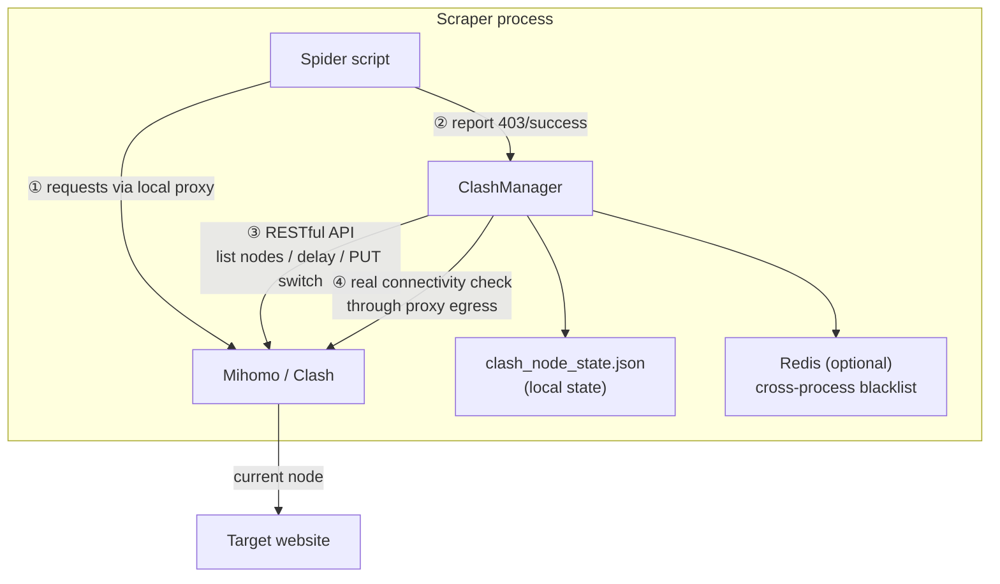

# Clash Proxy

<p align="center">
  
  
  
  
</p>

<p align="center">
  <b>Your airport subscription has 30 nodes. Your scraper uses 1.</b><br>
  The other 29 are idle — and your scraper is starving for proxies.
</p>

**clash_proxy turns those idle nodes into a scraping proxy pool**: auto health checks, auto rotation, auto failover on bans, self-healing overnight.

> One file · Three lines to integrate · Zero cost beyond your subscription

**中文文档：[README.md](README.md)**

---

## What problem does it solve

Scraping overseas sites means three proxy headaches:

| 😩 Pain | 💸 Usual answer | ✅ With clash_proxy |
|---------|-----------------|---------------------|
| **Proxies are expensive** — commercial pools bill by traffic; hundreds a month for a few thousand pages | Buy a plan, waste 90% of it | Reuse the **airport nodes you already pay for** — zero extra cost |
| **Bans stall your job** — site blocks your IP, you either babysit the client or let the task die overnight | Manual switching / spaghetti scripts | 3 consecutive 403s → **auto-switch**, job keeps running |
| **Node quality is a mystery** — which of those 30 nodes works? Which is fast? Which is already banned? | Test them one by one, by hand | Full latency sweep + pre-switch check + real post-switch verification — **only rotate through nodes that provably work** |

**TL;DR**: your airport subscription hides a mini proxy pool. This project turns it on.

---

## What it does, in 60 seconds

| Capability | In one sentence |
|------------|-----------------|
| 🔌 **Read** nodes | Pull real nodes from your subscription, filtering "remaining traffic" / "expiry" junk entries |
| 📶 **Test** nodes | Latency sweep + a real request through the proxy to your target site, **plus a measured exit IP to prove the switch actually took effect** |
| 🔄 **Rotate** nodes | Auto-switch on rejection/failure / every N downloads / background daemon self-healing |
| ⚖️ **Balance** load | 4 strategies: round-robin, random, fewest-rejections-first, least-used-first |
| 🧊 **Cooldown** & recover | Failed nodes cool down exponentially and rejoin rotation — nodes that recover aren't blacklisted forever |
| 💤 **Pool-wide breaker** | When every exit is dead, stay silent instead of probing — server-side throttling is sustained *by* request rate |
| 🎯 **Priority** | Pin/block specific nodes, restrict to certain regions, latency ceiling, prefer low-multiplier lines |
| 🔌 **Pluggable sources** | Nodes from a Clash selector / a static proxy list (no Clash needed) / several Clash instances aggregated |
| 🩺 **Health check** | `netcheck` in one screen: per-node latency, real exit IP, target verdict, distinct-exit count |
| 🧩 **One-line clients** | requests / aiohttp / curl_cffi / Playwright adapters — auto proxy, auto reconnect on switch |
| 📊 **See** everything | `stats` shows per-node downloads / rejections / cooldowns; `status` shows run mode and exit IP |

## Three lines to integrate

```python
from clash_manager import ClashManager

manager = ClashManager({
    "api_url": "http://127.0.0.1:9099",
    "secret": "your-secret",
    "post_switch_test_url": "https://your-target-site/",  # your actual target
})

proxies = manager.get_proxy_config()   # route all scraper traffic through this
```

Report the outcome honestly; everything else is automatic:

```python
try:
    resp = requests.get(url, proxies=proxies, timeout=30)
except requests.RequestException:
    manager.report_verdict("dead")       # timeout / reset — this exit is down
else:
    if resp.status_code == 200:
        manager.report_verdict("ok")     # success — bookkeeping + node reputation
    elif resp.status_code in (403, 429):
        manager.report_verdict("blocked")  # reached the site but was rejected
```

> **Why `report_verdict` instead of `increment_403_error`?**
> Whether a 403 means "this exit is banned" depends on the target site — for one site
> it's a permissions problem, for another it's a blocked IP. That judgement belongs to
> the caller, not the library. The legacy `increment_403_error()` /
> `increment_download_count()` still work (the former is `report_verdict("blocked")`).
>
> If your target signals blocking through a **business status code** (HTTP 200 but
> `{"code": 50000}`), just call `manager.report_verdict("blocked")` — the HTTP status
> doesn't matter.

### Or skip the boilerplate: one-line clients

`clash_clients.py` does all of the above for you — proxy wiring, reconnect-on-switch, verdict reporting:

```python
from clash_clients import session, aiohttp_session, curl_cffi_session, browser_context

with session(manager) as s:                       # requests
    r = s.get(url)

async with aiohttp_session(manager) as s:         # aiohttp (switching runs in a thread pool)
    async with s.get(url) as r: ...

with curl_cffi_session(manager, impersonate="chrome") as s:   # TLS fingerprint spoofing
    r = s.get(url)

async with browser_context(manager) as ctx:       # Playwright (real Chrome, not bundled Chromium)
    page = await ctx.new_page()
```

Full recipes for requests, curl_cffi and aiohttp: [docs/http-clients.md](docs/http-clients.md).
Driving a real browser (Playwright / Selenium): [docs/browser-clients.md](docs/browser-clients.md).

> **Note on languages**: the detailed docs under `docs/` are written in Chinese (the project's
> primary audience). This README and `AGENTS.md` cover everything needed to evaluate and use
> the project in English. Contributions of translated docs are welcome.

---

## Why not a commercial proxy pool?

| | 💰 Commercial pool | ✈️ Airport nodes + clash_proxy |
|--|--------------------|-------------------------------|
| Monthly cost | $50 ~ $500+ | **$0** (beyond your subscription) |
| Scale | Hundreds of req/s | **Light-weight scraping** (papers, public data, news, APIs) |
| Integration | Learn vendor SDKs, watch the meter | One file, three lines |
| Node ownership | Assigned by vendor, out of your control | Your subscription, add nodes anytime |

**Honest disclaimer**: airport nodes have limited bandwidth — this is not for
hundreds-of-requests-per-second workloads. But for tens of thousands of papers
or public records, a commercial pool is overkill, and your idle nodes fit
perfectly.

> Battle-tested in a real overseas academic-paper collection project:
> hundreds of automatic switches, dozens of fully-managed nodes, unattended runs.

---

## Architecture



---

## Quick Start

### Prerequisites

- Python 3.8+
- A running Clash / Mihomo instance (desktop client, or Docker)
- An airport subscription (or self-hosted nodes)
- Optional: Redis (cross-process error blacklist)

### Option 1: use your local Clash client (easiest)

Clash Verge / Clash for Windows / any client with a RESTful API works:

1. Enable "Allow LAN" in the client and note the proxy port (Clash Verge: `7897`; Clash for Windows: `7890`);
2. Find the external controller port (usually `9090`) and secret in client settings;
3. Install dependencies and verify:

```bash
pip install requests redis   # redis optional

export CLASH_API_URL="http://127.0.0.1:9090"   # your client's API port
export CLASH_PROXY_PORT="7897"                 # your client's proxy port
export CLASH_SECRET="your-secret"

python clash_cli.py test
# [✅] Clash API reachable
# [✅] Proxy egress works → ...
```

### Option 2: Docker Mihomo (recommended for servers)

```bash
# 1. Prepare the subscription config
cp config/config.example.yaml config/config.yaml
#    paste your subscription nodes into the proxies / proxy-groups sections
#    or sync from a subscription file:
#    CLASH_CONFIG_SOURCE=/path/to/sub.yaml ./scripts/sync_config.sh your-secret

# 2. Download geo databases (optional) — see config/README.md

# 3. Start
docker compose up -d

# 4. Verify
cp .env.example .env   # set secret
python clash_cli.py test
```

---

## CLI

```bash
python clash_cli.py list          # list all nodes + health
python clash_cli.py switch        # switch node (current strategy)
python clash_cli.py switch --random
python clash_cli.py switch --strategy least_403
python clash_cli.py status        # current state
python clash_cli.py stats         # per-node load stats (downloads / 403s)
python clash_cli.py health        # full latency sweep
python clash_cli.py test          # API + proxy egress connectivity
python clash_cli.py monitor       # background health daemon (30s interval)

python clash_cli.py netcheck      # health check: per-node latency / real exit IP / target verdict
python clash_cli.py netcheck --no-exit-ip          # skip exit IP (fast, and never switches nodes)
python clash_cli.py netcheck --probe 'POST:https://api.x.com/gen|code=50000'

python clash_cli.py priority --pin "<node name>"   # pin a known-good node
python clash_cli.py priority --block "<node>" --list
```

Environment variables can be placed in a `.env` file (see [.env.example](.env.example)).

---

## Configuration Reference

| Parameter | Default | Description |
|-----------|---------|-------------|
| `api_url` | `http://127.0.0.1:9097` | Clash external controller address |
| `secret` | `"1"` | API secret, must match config.yaml |
| `group_name` | `自动选择` | Selector group containing your nodes (auto-discovered if wrong) |
| `proxy_port` | `7897` | Local proxy port |
| `post_switch_test_url` | **required** | Connectivity-check URL after switching — **use your real target site** (blacklist is keyed by this domain) |
| `switch_strategy` | `round_robin` | `round_robin` / `random` / `least_403` / `least_used` |
| `max_downloads_per_node` | `500` | Downloads per node before rotation |
| `max_403_errors` | `3` | Consecutive rejections (403) before switching |
| `post_switch_timeout_sec` | `5` | Egress check timeout |
| `post_switch_max_retries` | `3` | Max candidate nodes per switch |
| `pre_switch_delay_check` | `true` | API delay pre-check before switching |
| `require_post_switch_connectivity` | `true` | Require real egress connectivity after switching |
| `only_use_verified_nodes` | `true` | Rotate only within the verified-node pool |
| `state_file` | `clash_node_state.json` | State file path |
| `show_node_info` | `true` | Print node list on startup |

**Exit verification / cooldown (new — keep the defaults)**

| Parameter | Default | Description |
|-----------|---------|-------------|
| `verify_exit_ip` | `true` | Compare the **real exit IP** before and after switching. The only reliable way to catch a switch that silently didn't happen |
| `exit_ip_url` | `https://api.ipify.org` | Exit-IP lookup endpoint |
| `exit_ip_timeout_sec` | `8` | Exit-IP lookup timeout |
| `allow_same_exit_ip` | `false` | Some providers share one egress IP across nodes — set `true` if so |
| `exit_ip_log_file` | `""` | If set, append `time / node / exit IP` to this TSV for provenance |
| `force_global_mode` | `false` | Switch to global mode on startup (`restore_mode()` reverts). **In rule mode, switching a selector has no effect on traffic** |
| `cooldown_base_sec` | `120` | First cooldown after a node failure; grows exponentially |
| `cooldown_max_sec` | `7200` | Cooldown ceiling (2 hours) |
| `health_check_workers` | `8` | Health-check concurrency cap. **Don't set it to the node count** — dozens of simultaneous probes against one site trigger server-side rate limiting |
| `health_check_url` | same as `post_switch_test_url` | Probe URL for delay/health checks. Defaults to the target site (do **not** use gstatic) |
| `health_check_timeout_ms` | `10000` | Delay-test timeout (5s kills healthy nodes when the target is a heavy page) |

---

## Core Mechanisms (lessons from production)

1. **Triple verification** — an API 204 doesn't mean the node can reach the internet, and it certainly doesn't mean **traffic actually moved to a new egress**:
   ① pre-switch API latency check skips obviously-unusable candidates;
   ② a real request through the proxy must come back with **any HTTP response** (a 403 counts as reachable — on risk-controlled sites a 403 often means the node is fine, and treating it as "dead" kills good nodes);
   ③ the **measured exit IP** must differ from before the switch.
2. **Exponential cooldown, not permanent blacklisting** — a failed node cools down for `120s × 2ⁿ` (capped at 2 h) and then rejoins rotation. Most failures heal on their own (IP rate limits recovered in ~1 h in testing); permanent blacklisting throws away nodes that would have come back.
3. **Per-site blacklist** — the Redis key contains the target site's domain, so a node banned by site A still works for site B.
4. **Over-kill protection** — when the blacklist size approaches the total node count, it's cleared automatically to avoid deadlock.
5. **Subscription metadata filtering** — entries like "remaining traffic" or "expiry" are filtered out; the single word "traffic" must NOT be used as a filter since node names often contain "traffic multiplier" and would all be killed.
6. **Bounded health-check concurrency** — 8 by default. Dozens of nodes probing one target site looks harmless per-request, but the **aggregate rate is enough to trip server-side rate limiting**.
7. **Locked + merged state file** — with several processes sharing `state_file`, counters are merged key-by-key on write, so a late writer can't wipe another process's node reputation.
8. **Verdicts belong to the caller** — `report_verdict("ok"/"blocked"/"dead")`. The same 403 means "missing permission" on one site and "banned IP" on another; that call shouldn't be hard-coded in the library.

---

## Repository Layout

```
clash_proxy/
├── clash_manager.py          # core: ClashManager (single file, no framework deps)
├── clash_cli.py              # CLI tool (9 subcommands)
│
│   ── optional extension modules: delete them and the two above still work ──
├── clash_sources.py          # pluggable proxy sources (selector / static list / multi-instance)
├── clash_policy.py           # node priority (pin/block/region/latency/multiplier)
├── clash_probe.py            # site probe, per-node exit IP, network health check
├── clash_clients.py          # requests / aiohttp / curl_cffi / Playwright adapters
├── docker-compose.yml        # Mihomo Docker deployment
├── .env.example              # environment variable template
├── config/
│   ├── config.example.yaml   # sanitized Clash config template (with comments)
│   └── README.md             # config & geo database notes
├── scripts/
│   └── sync_config.sh        # sync config from a subscription file
├── tests/
│   ├── sources_test.py       # offline unit tests (no network, no Clash — CI-friendly)
│   ├── smoke_test.py         # read-only self-check (safe to run during a scrape)
│   └── switch_live_test.py   # live switch test (switches nodes; use a spare Clash instance)
└── docs/
    ├── quickstart.md         # zero-to-one tutorial
    ├── config-guide.md       # Clash config explained (fields / import / pitfalls)
    ├── logic.md              # internals: switch state machine, cooldown, threading
    ├── http-clients.md       # usage with requests / curl_cffi / aiohttp
    └── browser-clients.md    # usage with Playwright / Selenium (incl. battle-tested pitfalls)
```

## Documentation

| Doc | Covers |
|-----|--------|
| [docs/quickstart.md](docs/quickstart.md) | Zero to one: deploy → subscription → first scraper |
| [docs/config-guide.md](docs/config-guide.md) | Clash config field-by-field, three import methods, pitfalls |
| [docs/logic.md](docs/logic.md) | Internals: switch state machine, triple verification, cooldown |
| [docs/http-clients.md](docs/http-clients.md) | Full usage with requests / curl_cffi / aiohttp |
| [docs/browser-clients.md](docs/browser-clients.md) | Full usage with Playwright / Selenium |
| [AGENTS.md](AGENTS.md) | For AI coding agents: conventions, change guide, hard-won lessons |
| [llms.txt](llms.txt) | Curated doc index for LLMs ([llmstxt.org](https://llmstxt.org)) |
| [CHANGELOG.md](CHANGELOG.md) | Version history |
| [CONTRIBUTING.md](CONTRIBUTING.md) | How to contribute, how to run tests |
| [SECURITY.md](SECURITY.md) | Security notes (port exposure, credentials, scope) |

---

## FAQ

**Q: The log says the switch succeeded, but I suspect I'm still on the same egress.**
That silent no-op is exactly what `verify_exit_ip` (on by default) catches — it measures the
real exit IP before and after the switch. The two usual causes:

1. **Clash is in rule mode** — traffic follows the rule chain, so `PUT /proxies/<group>` only
   changes the group's `now` and has no effect on traffic. Rotating egress per node requires
   **global mode** (where the `GLOBAL` group *is* the egress). Set `force_global_mode: true`
   to switch automatically on startup.
2. **keep-alive reusing the old connection** — mihomo picks an egress per connection, so
   connections opened before the switch keep using the old node. Reconnect (new Session /
   `Connection: close` / page reload) to move to the new egress.

Note: a few providers share one exit IP across several nodes — set `allow_same_exit_ip: true`
in that case.

**Q: Should I raise the health-check concurrency to the node count?**
No. `health_check_workers` defaults to 8 on purpose: dozens of nodes hitting one target
site at once looks gentle per-request, but the **aggregate rate is enough to trigger
server-side rate limiting** (risk engines look at total rate, not individual requests).

**Q: Is a banned node gone forever?**
No. Failures put a node into **exponential cooldown** (`cooldown_base_sec × 2ⁿ`, capped by
`cooldown_max_sec`); it rejoins rotation afterwards. IP rate limits typically healed in about
an hour in testing, so permanent blacklisting would waste nodes that recover.

**Q: Self-check without touching my running scrape?**
`python tests/smoke_test.py` is read-only and never switches nodes.

**Q: Is Docker required?**
No. Any Clash/Mihomo instance with a RESTful API works — desktop client, router, server. Just adjust `api_url` / `proxy_port`.

**Q: Why set `post_switch_test_url` to my target site?**
The error blacklist is keyed by that domain, and the post-switch check then verifies exactly what you care about: can this node reach my target?

**Q: What if every node gets blacklisted?**
No deadlock: the blacklist auto-clears when it approaches the total node count, and a full scan fallback kicks in when switching fails.

**Q: Is Redis required?**
No. Without it the blacklist degrades to in-process memory — fine for a single process. Redis is only needed to share the blacklist across processes.

**Q: Does it scale to heavy scraping?**
No. Airport nodes have limited bandwidth; this tool targets "small data + limited nodes". Use a commercial proxy pool for heavy workloads.

---

## Security Notes

- Never commit `config/config.yaml` with real nodes (already git-ignored);
- Proxy and API ports listen on `127.0.0.1` only — don't expose them publicly;
- Respect target sites' robots.txt and local regulations.

## License

[MIT](LICENSE) © Jimmy Smile
