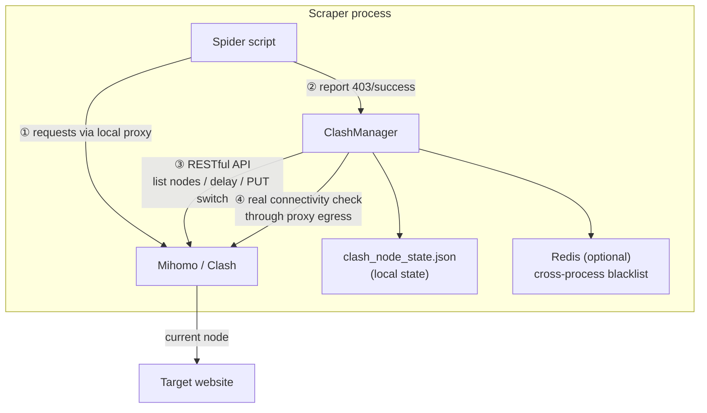

# Clash Proxy

<p align="center">
  
  
  
  
</p>

<p align="center">
  <b>Your airport subscription has 30 nodes. Your scraper uses 1.</b><br>
  The other 29 are idle — and your scraper is starving for proxies.
</p>

**clash_proxy turns those idle nodes into a scraping proxy pool**: auto health checks, auto rotation, auto failover on bans, self-healing overnight.

> One file · Three lines to integrate · Zero cost beyond your subscription

**中文文档：[README.md](README.md)**

---

## What problem does it solve

Scraping overseas sites means three proxy headaches:

| 😩 Pain | 💸 Usual answer | ✅ With clash_proxy |
|---------|-----------------|---------------------|
| **Proxies are expensive** — commercial pools bill by traffic; hundreds a month for a few thousand pages | Buy a plan, waste 90% of it | Reuse the **airport nodes you already pay for** — zero extra cost |
| **Bans stall your job** — site blocks your IP, you either babysit the client or let the task die overnight | Manual switching / spaghetti scripts | 3 consecutive 403s → **auto-switch**, job keeps running |
| **Node quality is a mystery** — which of those 30 nodes works? Which is fast? Which is already banned? | Test them one by one, by hand | Full latency sweep + pre-switch check + real post-switch verification — **only rotate through nodes that provably work** |

**TL;DR**: your airport subscription hides a mini proxy pool. This project turns it on.

---

## What it does, in 60 seconds

| Capability | In one sentence |
|------------|-----------------|
| 🔌 **Read** nodes | Pull real nodes from your subscription, filtering "remaining traffic" / "expiry" junk entries |
| 📶 **Test** nodes | Full latency sweep + a real request through the proxy to your target site |
| 🔄 **Rotate** nodes | Auto-switch after 3× 403 / every N downloads / background daemon self-healing |
| ⚖️ **Balance** load | 4 strategies: round-robin, random, fewest-403s-first, least-used-first |
| 📊 **See** everything | `stats` shows per-node download counts and 403 history |

## Three lines to integrate

```python
from clash_manager import ClashManager

manager = ClashManager({
    "api_url": "http://127.0.0.1:9099",
    "secret": "your-secret",
    "post_switch_test_url": "https://your-target-site/",  # your actual target
})

proxies = manager.get_proxy_config()   # route all scraper traffic through this
```

Two report calls in your request loop, everything else is automatic:

```python
resp = requests.get(url, proxies=proxies, timeout=30)

if resp.status_code == 403:
    manager.increment_403_error()        # banned? 3 strikes → auto-switch
elif resp.status_code == 200:
    manager.increment_download_count()   # success — load-balancing bookkeeping
```

Full recipes for requests, curl_cffi and aiohttp: [docs/http-clients.md](docs/http-clients.md).

---

## Why not a commercial proxy pool?

| | 💰 Commercial pool | ✈️ Airport nodes + clash_proxy |
|--|--------------------|-------------------------------|
| Monthly cost | $50 ~ $500+ | **$0** (beyond your subscription) |
| Scale | Hundreds of req/s | **Light-weight scraping** (papers, public data, news, APIs) |
| Integration | Learn vendor SDKs, watch the meter | One file, three lines |
| Node ownership | Assigned by vendor, out of your control | Your subscription, add nodes anytime |

**Honest disclaimer**: airport nodes have limited bandwidth — this is not for
hundreds-of-requests-per-second workloads. But for tens of thousands of papers
or public records, a commercial pool is overkill, and your idle nodes fit
perfectly.

> Battle-tested in a real overseas academic-paper collection project:
> hundreds of automatic switches, dozens of fully-managed nodes, unattended runs.

---

## Architecture



---

## Quick Start

### Prerequisites

- Python 3.8+
- A running Clash / Mihomo instance (desktop client, or Docker)
- An airport subscription (or self-hosted nodes)
- Optional: Redis (cross-process error blacklist)

### Option 1: use your local Clash client (easiest)

Clash Verge / Clash for Windows / any client with a RESTful API works:

1. Enable "Allow LAN" in the client and note the proxy port (Clash Verge: `7897`; Clash for Windows: `7890`);
2. Find the external controller port (usually `9090`) and secret in client settings;
3. Install dependencies and verify:

```bash
pip install requests redis   # redis optional

export CLASH_API_URL="http://127.0.0.1:9090"   # your client's API port
export CLASH_PROXY_PORT="7897"                 # your client's proxy port
export CLASH_SECRET="your-secret"

python clash_cli.py test
# [✅] Clash API reachable
# [✅] Proxy egress works → ...
```

### Option 2: Docker Mihomo (recommended for servers)

```bash
# 1. Prepare the subscription config
cp config/config.example.yaml config/config.yaml
#    paste your subscription nodes into the proxies / proxy-groups sections
#    or sync from a subscription file:
#    CLASH_CONFIG_SOURCE=/path/to/sub.yaml ./scripts/sync_config.sh your-secret

# 2. Download geo databases (optional) — see config/README.md

# 3. Start
docker compose up -d

# 4. Verify
cp .env.example .env   # set secret
python clash_cli.py test
```

---

## CLI

```bash
python clash_cli.py list          # list all nodes + health
python clash_cli.py switch        # switch node (current strategy)
python clash_cli.py switch --random
python clash_cli.py switch --strategy least_403
python clash_cli.py status        # current state
python clash_cli.py stats         # per-node load stats (downloads / 403s)
python clash_cli.py health        # full latency sweep
python clash_cli.py test          # API + proxy egress connectivity
python clash_cli.py monitor       # background health daemon (30s interval)
```

Environment variables can be placed in a `.env` file (see [.env.example](.env.example)).

---

## Configuration Reference

| Parameter | Default | Description |
|-----------|---------|-------------|
| `api_url` | `http://127.0.0.1:9097` | Clash external controller address |
| `secret` | `"1"` | API secret, must match config.yaml |
| `group_name` | `自动选择` | Selector group containing your nodes (auto-discovered if wrong) |
| `proxy_port` | `7897` | Local proxy port |
| `post_switch_test_url` | **required** | Connectivity-check URL after switching — **use your real target site** (blacklist is keyed by this domain) |
| `switch_strategy` | `round_robin` | `round_robin` / `random` / `least_403` / `least_used` |
| `max_downloads_per_node` | `500` | Downloads per node before rotation |
| `max_403_errors` | `3` | Consecutive 403s before switching |
| `post_switch_timeout_sec` | `5` | Egress check timeout |
| `post_switch_max_retries` | `3` | Max candidate nodes per switch |
| `pre_switch_delay_check` | `true` | API delay pre-check before switching |
| `require_post_switch_connectivity` | `true` | Require real egress connectivity after switching |
| `only_use_verified_nodes` | `true` | Rotate only within the verified-node pool |
| `state_file` | `clash_node_state.json` | State file path |
| `show_node_info` | `true` | Print node list on startup |

---

## Core Mechanisms (lessons from production)

1. **Dual verification** — an API 204 doesn't mean the node can actually reach the internet. After switching, a real request through the proxy egress (200/204) is required, otherwise the next candidate is tried immediately.
2. **Per-site blacklist** — the Redis key contains the target site's domain, so a node banned by site A still works for site B.
3. **Over-kill protection** — when the blacklist size approaches the total node count, it's cleared automatically to avoid deadlock.
4. **Subscription metadata filtering** — entries like "remaining traffic" or "expiry" are filtered out; the single word "traffic" must NOT be used as a filter since node names often contain "traffic multiplier" and would all be killed.
5. **Pre-switch delay check** — candidates with unusable API latency are skipped before the PUT + sleep, saving a wasted switch cycle.

---

## Repository Layout

```
clash_proxy/
├── clash_manager.py          # core: ClashManager (single file)
├── clash_cli.py              # CLI tool
├── docker-compose.yml        # Mihomo Docker deployment
├── .env.example              # environment variable template
├── config/
│   ├── config.example.yaml   # sanitized Clash config template (with comments)
│   └── README.md             # config & geo database notes
├── scripts/
│   └── sync_config.sh        # sync config from a subscription file
└── docs/
    ├── quickstart.md         # zero-to-one tutorial
    ├── config-guide.md       # Clash config explained (fields / import / pitfalls)
    ├── logic.md              # internals: switch state machine, blacklist, threading
    └── http-clients.md       # usage with requests / curl_cffi / aiohttp
```

## Documentation

| Doc | Covers |
|-----|--------|
| [docs/quickstart.md](docs/quickstart.md) | Zero to one: deploy → subscription → first scraper |
| [docs/config-guide.md](docs/config-guide.md) | Clash config field-by-field, three import methods, pitfalls |
| [docs/logic.md](docs/logic.md) | Internals: switch state machine, dual verification, blacklist |
| [docs/http-clients.md](docs/http-clients.md) | Full usage with requests / curl_cffi / aiohttp |

---

## FAQ

**Q: Is Docker required?**
No. Any Clash/Mihomo instance with a RESTful API works — desktop client, router, server. Just adjust `api_url` / `proxy_port`.

**Q: Why set `post_switch_test_url` to my target site?**
The error blacklist is keyed by that domain, and the post-switch check then verifies exactly what you care about: can this node reach my target?

**Q: What if every node gets blacklisted?**
No deadlock: the blacklist auto-clears when it approaches the total node count, and a full scan fallback kicks in when switching fails.

**Q: Is Redis required?**
No. Without it the blacklist degrades to in-process memory — fine for a single process. Redis is only needed to share the blacklist across processes.

**Q: Does it scale to heavy scraping?**
No. Airport nodes have limited bandwidth; this tool targets "small data + limited nodes". Use a commercial proxy pool for heavy workloads.

---

## Security Notes

- Never commit `config/config.yaml` with real nodes (already git-ignored);
- Proxy and API ports listen on `127.0.0.1` only — don't expose them publicly;
- Respect target sites' robots.txt and local regulations.

## License

[MIT](LICENSE) © Jimmy Smile
