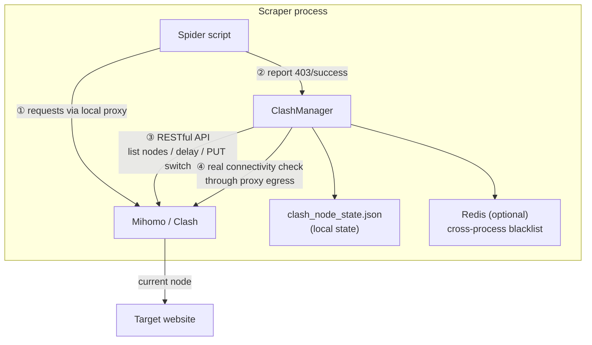

# Clash Proxy — Airport Node Proxy Pool Manager

<p align="center">
  
  
  
  
</p>

> Turn the "unused nodes" in your airport subscription into a scraping proxy pool: node discovery, latency testing, health checks, load balancing, and automatic failover — in a single file.

**中文文档：[README.md](README.md)**

---

## Why this exists (Use Case)

Overseas scraping has an annoying proxy cost problem:

- **Commercial proxy pools** (residential/DC IPs) are billed by traffic — thousands of dollars a month, total overkill for light data collection;
- **Airport subscriptions** give you a dozen or dozens of nodes for a few dollars a month — and people typically use only one or two of them. The other 90% sit idle.

**This project fixes exactly that**: when your task only needs a small amount of data (academic papers, public datasets, foreign news, API data…), a handful of airport nodes is more than enough. Clash Proxy manages those nodes for you:

| Capability | Description |
|------------|-------------|
| 🔌 Node discovery | Pull all nodes from a Clash proxy group; auto-filter subscription metadata ("expiry", "remaining traffic"), nested groups, unsupported types |
| 📶 Node testing | Clash API latency test **plus** real-world connectivity check through the proxy egress — dual verification |
| 🔄 Node rotation | Auto-switch triggered by download count or 403 count; four load-balancing strategies |
| ⚖️ Load balancing | `round_robin` / `random` / `least_403` / `least_used` |
| 🛡️ Node management | Verified-node pool, per-site error blacklist, over-kill protection, background health daemon |
| 💾 Persistence | Local JSON state + optional Redis for cross-process blacklist sharing |

> ⚠️ **Scope**: this is NOT a proxy service (it provides no IPs) and does no concurrent dialing. It manages the *limited nodes* in your subscription — built for "small data + limited nodes". For hundreds of requests per second, use a commercial proxy pool.

---

## Architecture



---

## Quick Start

### Prerequisites

- Python 3.8+
- A running Clash / Mihomo instance (desktop client, or Docker)
- An airport subscription (or self-hosted nodes)
- Optional: Redis (cross-process error blacklist)

### Option 1: use your local Clash client (easiest)

Clash Verge / Clash for Windows / any client with a RESTful API works:

1. Enable "Allow LAN" in the client and note the proxy port (Clash Verge: `7897`; Clash for Windows: `7890`);
2. Find the external controller port (usually `9090`) and secret in client settings;
3. Install dependencies and verify:

```bash
pip install requests redis   # redis optional

export CLASH_API_URL="http://127.0.0.1:9090"   # your client's API port
export CLASH_PROXY_PORT="7897"                 # your client's proxy port
export CLASH_SECRET="your-secret"

python clash_cli.py test
# [✅] Clash API reachable
# [✅] Proxy egress works → ...
```

### Option 2: Docker Mihomo (recommended for servers)

```bash
# 1. Prepare the subscription config
cp config/config.example.yaml config/config.yaml
#    paste your subscription nodes into the proxies / proxy-groups sections
#    or sync from a subscription file:
#    CLASH_CONFIG_SOURCE=/path/to/sub.yaml ./scripts/sync_config.sh your-secret

# 2. Download geo databases (optional) — see config/README.md

# 3. Start
docker compose up -d

# 4. Verify
cp .env.example .env   # set secret
python clash_cli.py test
```

---

## Scraper Integration

```python
from clash_manager import ClashManager

manager = ClashManager({
    "api_url": "http://127.0.0.1:9099",
    "secret": "your-secret",
    "group_name": "🚀节点选择",               # the proxy group your nodes live in
    "proxy_port": 7777,                        # local proxy port
    "post_switch_test_url": "https://target-site/",  # IMPORTANT: use your real target
    "switch_strategy": "least_403",
    "max_downloads_per_node": 500,
})

# route all requests through the local proxy
proxies = manager.get_proxy_config()

for url in url_list:
    resp = requests.get(url, proxies=proxies, timeout=30)

    if resp.status_code == 403:
        manager.increment_403_error()      # 3 strikes → auto switch node
    elif resp.status_code == 200:
        manager.increment_download_count() # rotate after 500 downloads (load balance)
        save(resp.content)

# optional: background daemon — auto-switch if the node dies mid-run
manager.start_auto_health_check(interval_sec=30)
```

All methods are thread-safe (switches are serialized internally).

---

## CLI

```bash
python clash_cli.py list          # list all nodes + health
python clash_cli.py switch        # switch node (current strategy)
python clash_cli.py switch --random
python clash_cli.py switch --strategy least_403
python clash_cli.py status        # current state
python clash_cli.py stats         # per-node load stats (downloads / 403s)
python clash_cli.py health        # full latency sweep
python clash_cli.py test          # API + proxy egress connectivity
python clash_cli.py monitor       # background health daemon (30s interval)
```

Environment variables can be placed in a `.env` file (see [.env.example](.env.example)).

---

## Configuration Reference

| Parameter | Default | Description |
|-----------|---------|-------------|
| `api_url` | `http://127.0.0.1:9097` | Clash external controller address |
| `secret` | `"1"` | API secret, must match config.yaml |
| `group_name` | `自动选择` | Selector group containing your nodes (auto-discovered if wrong) |
| `proxy_port` | `7897` | Local proxy port |
| `post_switch_test_url` | **required** | Connectivity-check URL after switching — **use your real target site** (blacklist is keyed by this domain) |
| `switch_strategy` | `round_robin` | `round_robin` / `random` / `least_403` / `least_used` |
| `max_downloads_per_node` | `500` | Downloads per node before rotation |
| `max_403_errors` | `3` | Consecutive 403s before switching |
| `post_switch_timeout_sec` | `5` | Egress check timeout |
| `post_switch_max_retries` | `3` | Max candidate nodes per switch |
| `pre_switch_delay_check` | `true` | API delay pre-check before switching |
| `require_post_switch_connectivity` | `true` | Require real egress connectivity after switching |
| `only_use_verified_nodes` | `true` | Rotate only within the verified-node pool |
| `state_file` | `clash_node_state.json` | State file path |
| `show_node_info` | `true` | Print node list on startup |

---

## Core Mechanisms (lessons from production)

1. **Dual verification** — an API 204 doesn't mean the node can actually reach the internet. After switching, a real request through the proxy egress (200/204) is required, otherwise the next candidate is tried immediately.
2. **Per-site blacklist** — the Redis key contains the target site's domain, so a node banned by site A still works for site B.
3. **Over-kill protection** — when the blacklist size approaches the total node count, it's cleared automatically to avoid deadlock.
4. **Subscription metadata filtering** — entries like "remaining traffic" or "expiry" are filtered out; the single word "traffic" must NOT be used as a filter since node names often contain "traffic multiplier" and would all be killed.
5. **Pre-switch delay check** — candidates with unusable API latency are skipped before the PUT + sleep, saving a wasted switch cycle.

---

## Repository Layout

```
clash_proxy/
├── clash_manager.py          # core: ClashManager (single file)
├── clash_cli.py              # CLI tool
├── docker-compose.yml        # Mihomo Docker deployment
├── .env.example              # environment variable template
├── config/
│   ├── config.example.yaml   # sanitized Clash config template
│   └── README.md             # config & geo database notes
├── scripts/
│   └── sync_config.sh        # sync config from a subscription file
└── docs/
    └── quickstart.md         # zero-to-one tutorial
```

---

## FAQ

**Q: Is Docker required?**
No. Any Clash/Mihomo instance with a RESTful API works — desktop client, router, server. Just adjust `api_url` / `proxy_port`.

**Q: Why set `post_switch_test_url` to my target site?**
The error blacklist is keyed by that domain, and the post-switch check then verifies exactly what you care about: can this node reach my target?

**Q: What if every node gets blacklisted?**
No deadlock: the blacklist auto-clears when it approaches the total node count, and a full scan fallback kicks in when switching fails.

**Q: Is Redis required?**
No. Without it the blacklist degrades to in-process memory — fine for a single process. Redis is only needed to share the blacklist across processes.

**Q: Does it scale to heavy scraping?**
No. Airport nodes have limited bandwidth; this tool targets "small data + limited nodes". Use a commercial proxy pool for heavy workloads.

---

## Security Notes

- Never commit `config/config.yaml` with real nodes (already git-ignored);
- Proxy and API ports listen on `127.0.0.1` only — don't expose them publicly;
- Respect target sites' robots.txt and local regulations.

## License

[MIT](LICENSE) © Jimmy Smile
