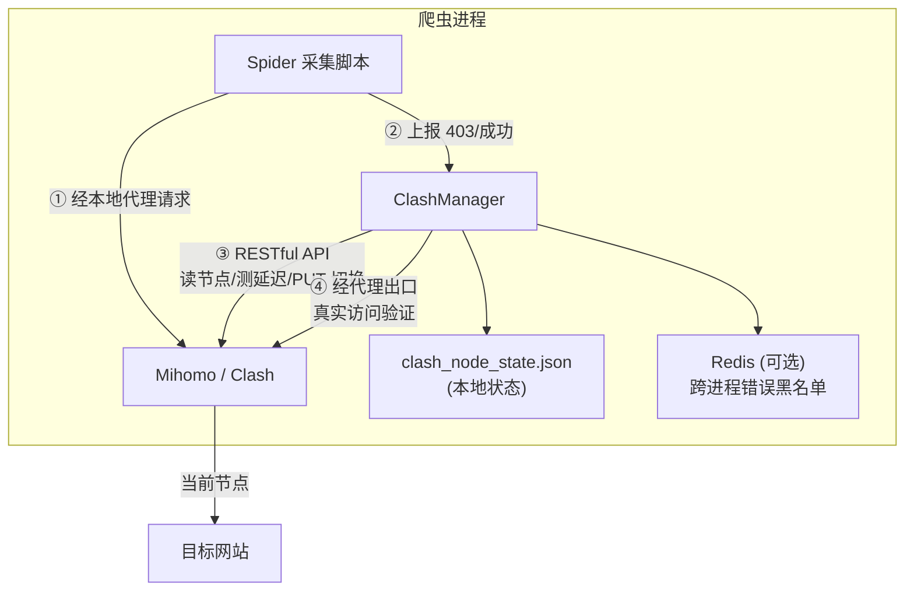

# Clash Proxy

<p align="center">
  
  
  
  
</p>

<p align="center">
  <b>你的机场订阅里有 30 个节点，爬虫只用了 1 个。</b><br>
  剩下 29 个在吃灰 —— 而你的爬虫，正缺代理。
</p>

**clash_proxy 把吃灰的节点管成爬虫代理池**：自动测速、自动轮换、被封自动切换、半夜挂掉自愈。

> 一个文件 · 三行代码接入 · 机场订阅费之外零成本

**English: [README.en.md](README.en.md)**

---

## 它解决什么问题

做海外采集，代理是三座绕不开的大山。爬虫人的真实日常：

| 😩 你的痛点 | 💸 目前的解法 | ✅ 有了 clash_proxy |
|-------------|---------------|---------------------|
| **代理太贵** — 采几千条数据，商业海外代理却按大规模流量计费，一个月几百上千块 | 咬着牙买流量包，90% 用不完 | 用你**已有的机场节点**，订阅费之外零成本 |
| **封 IP 就断活** — 目标站一封，要么手动去客户端点切换，要么任务挂到天亮 | 人肉盯着 / 写一坨切换脚本 | 连续 3 次 403 **自动切节点**，任务继续跑 |
| **节点好坏全靠蒙** — 机场几十个节点，哪个能用？哪个快？哪个已经被封？ | 挨个手动测，换一个试一个 | 全量测速 + 切换前预检 + 切换后真实验证，**只轮换确认能用的** |

**一句话总结**：你买的机场订阅里，藏着一个小型代理池。本项目负责把它开起来。

---

## 一分钟看懂它能干什么

| 能力 | 一句话说明 |
|------|-----------|
| 🔌 **读**节点 | 自动从订阅里挑出真实节点，过滤「剩余流量」「到期时间」等垃圾条目 |
| 📶 **测**节点 | 全量延迟测试 + 经代理真实访问你的目标站，双重确认 |
| 🔄 **换**节点 | 3 次 403 自动切 / 每下载 N 次轮换 / 后台守护自愈 |
| ⚖️ **均衡**负载 | 4 种策略：轮流用、随机、谁 403 少用谁、谁用得少用谁 |
| 📊 **看**得见 | `stats` 命令直接看每个节点的下载次数和 403 历史 |

## 三行代码接入爬虫

```python
from clash_manager import ClashManager

manager = ClashManager({
    "api_url": "http://127.0.0.1:9099",        # Clash API 地址
    "secret": "your-secret",
    "post_switch_test_url": "https://你的目标站/",  # 就填你要采集的站
})

proxies = manager.get_proxy_config()   # 爬虫所有请求走这个
```

请求处只需两个上报，其余全自动：

```python
resp = requests.get(url, proxies=proxies, timeout=30)

if resp.status_code == 403:
    manager.increment_403_error()        # 被封了？攒满 3 次自动换节点
elif resp.status_code == 200:
    manager.increment_download_count()   # 下载成功，负载均衡自动记账
```

requests、curl_cffi、aiohttp 的完整写法见 [docs/http-clients.md](docs/http-clients.md)。

---

## 为什么不用商业代理池？

| | 💰 商业海外代理池 | ✈️ 机场节点 + clash_proxy |
|--|------------------|--------------------------|
| 月成本 | 几百 ~ 上千元 | **0**（订阅费之外） |
| 适用量级 | 每秒上百请求的大规模采集 | **少量数据采集**（学术文献、公开数据、新闻、API） |
| 接入成本 | 学习各家 SDK、按流量对账 | 一个文件，三行代码 |
| 节点来源 | 服务商分配，不可控 | 你自己的订阅，随时加节点 |

**诚实声明**：机场节点带宽有限，本项目不适用于每秒上百请求的重型采集。
但如果你要采的是几万条文献、几万条公开数据——商业代理池是杀鸡用牛刀，
吃灰的机场节点刚刚好。

> 本项目已在真实海外文献采集项目中长期运行：数百次自动切换、数十个节点
> 全托管、任务全程无人值守。

---

## 架构



---

## 快速开始

### 前提

- Python 3.8+
- 一个 Clash / Mihomo 实例（本地 Clash 客户端，或 Docker 部署）
- 一份机场订阅（或自建节点）
- 可选：Redis（跨进程共享错误黑名单）

### 方式一：使用本地 Clash 客户端（最简单）

Windows/macOS 的 Clash Verge / Clash for Windows 等客户端都内置了 RESTful API：

1. 打开客户端的「允许局域网访问/Allow LAN」并记下端口（Clash Verge 默认 `7897`，Clash for Windows 默认 `7890`）；
2. 在客户端「设置 → 外部控制」找到 API 端口（一般 `9090`）和密钥（secret）；
3. 安装依赖并验证：

```bash
pip install requests redis   # redis 可选

export CLASH_API_URL="http://127.0.0.1:9090"   # 你客户端的 API 端口
export CLASH_PROXY_PORT="7897"                 # 你客户端的代理端口
export CLASH_SECRET="你的密钥"

python clash_cli.py test
# [✅] Clash API 可达
# [✅] 代理出口可用 → ...
```

### 方式二：Docker 部署 Mihomo（推荐用于服务器）

```bash
# 1. 准备订阅配置
cp config/config.example.yaml config/config.yaml
#    把订阅内容粘贴进 config.yaml 的 proxies / proxy-groups 段
#    或使用脚本从订阅文件同步:
#    CLASH_CONFIG_SOURCE=/path/to/sub.yaml ./scripts/sync_config.sh your-secret

# 2. 下载地理数据库（可选）
#    见 config/README.md

# 3. 启动
docker compose up -d

# 4. 验证
cp .env.example .env   # 修改 secret 为 your-secret
python clash_cli.py test
```

---

## CLI 使用

```bash
python clash_cli.py list          # 列出所有节点 + 健康状态
python clash_cli.py switch        # 切换节点(按当前策略)
python clash_cli.py switch --random
python clash_cli.py switch --strategy least_403
python clash_cli.py status        # 当前状态
python clash_cli.py stats         # 各节点负载统计(下载/403 次数)
python clash_cli.py health        # 全量测延迟
python clash_cli.py test          # API + 代理出口连通性
python clash_cli.py monitor       # 后台健康守护(每 30s 巡检)
```

环境变量可写入项目根目录 `.env` 文件（见 [.env.example](.env.example)）。

---

## 配置项说明

| 参数 | 默认值 | 说明 |
|------|--------|------|
| `api_url` | `http://127.0.0.1:9097` | Clash 外部控制地址 |
| `secret` | `"1"` | API 密钥，与 config.yaml 一致 |
| `group_name` | `自动选择` | 节点所在策略组（Selector）名；填错会自动发现 |
| `proxy_port` | `7897` | 本地代理端口 |
| `post_switch_test_url` | **必填** | 切换后连通性检测 URL，**建议填实际采集的目标站**（按站点隔离错误黑名单） |
| `switch_strategy` | `round_robin` | 负载均衡策略：`round_robin` / `random` / `least_403` / `least_used` |
| `max_downloads_per_node` | `500` | 每节点最大下载次数，达到即轮换 |
| `max_403_errors` | `3` | 累计多少次 403 触发切换 |
| `post_switch_timeout_sec` | `5` | 出口连通性检测超时 |
| `post_switch_max_retries` | `3` | 切换尝试的候选节点数上限 |
| `pre_switch_delay_check` | `true` | 切换前用 API 测候选节点延迟，跳过不可用节点 |
| `require_post_switch_connectivity` | `true` | 切换后必须经代理出口真实访问外网才确认成功 |
| `only_use_verified_nodes` | `true` | 只在已验证节点池内轮换 |
| `state_file` | `clash_node_state.json` | 状态持久化文件路径 |
| `show_node_info` | `true` | 启动时打印节点列表 |

---

## 核心机制（生产踩坑沉淀）

1. **双重验证切换** — 仅 API 返回 204 不代表节点真能上网。切换后必须经本地代理出口真实访问目标站（200/204）才算成功，否则立即换下一个候选。
2. **错误黑名单按站点隔离** — Redis key 含目标站域名：A 站封的节点不影响 B 站使用。
3. **误杀保护** — 错误节点数与总节点数接近时自动清空黑名单，防止「全军覆没」死锁。
4. **订阅元数据过滤** — 过滤「剩余流量」「到期时间」等条目；注意不能用单独的「流量」二字过滤，节点名常含「流量倍率」会误杀全部线路。
5. **切换前延迟预检** — 先用 API 测候选节点延迟，跳过明显不可用的，避免白等 set_node + sleep。

---

## 目录结构

```
clash_proxy/
├── clash_manager.py          # 核心: ClashManager(单文件, 约700行)
├── clash_cli.py              # CLI 工具
├── docker-compose.yml        # Mihomo Docker 部署
├── .env.example              # 环境变量模板
├── config/
│   ├── config.example.yaml   # Clash 配置示例(脱敏, 带讲解注释)
│   └── README.md             # 配置文件/地理数据库说明
├── scripts/
│   └── sync_config.sh        # 从订阅文件同步配置
└── docs/
    ├── quickstart.md         # 从零到一教程
    ├── config-guide.md       # Clash 配置文件讲解（字段/导入方式/常见坑）
    ├── logic.md              # ClashManager 逻辑介绍（切换状态机/黑名单/线程安全）
    └── http-clients.md       # 搭配 requests / curl_cffi / aiohttp 用法大全
```

## 文档导航

| 文档 | 内容 |
|------|------|
| [docs/quickstart.md](docs/quickstart.md) | 从零到一：部署 → 订阅 → 第一个采集脚本 |
| [docs/config-guide.md](docs/config-guide.md) | Clash 配置文件逐字段讲解、订阅导入三种方式、常见坑 |
| [docs/logic.md](docs/logic.md) | ClashManager 内部逻辑：切换状态机、双重验证、黑名单机制 |
| [docs/http-clients.md](docs/http-clients.md) | 代理池搭配 requests / curl_cffi / aiohttp 的完整写法 |

---

## FAQ

**Q: 必须用 Docker 吗？**
不用。任何带 RESTful API 的 Clash/Mihomo 实例都可以：本地 Clash Verge、软路由、服务器上的 Clash 都行，改 `api_url` / `proxy_port` 即可。

**Q: 为什么建议 `post_switch_test_url` 填目标站？**
错误黑名单按该域名隔离；同时切换后验证的就是「这个节点能不能访问你的目标站」，比通用的 204 检测更可靠。

**Q: 节点全被拉黑了怎么办？**
不会死锁：黑名单数量与节点总数接近时自动清空；切换失败还会走全量扫描兜底。

**Q: Redis 一定要装吗？**
不必。未安装时错误黑名单自动降级为进程内内存，单进程采集完全够用；多进程共享黑名单才需要。

**Q: 大规模采集适用吗？**
不适用。机场节点带宽有限，本工具定位是「少量数据 + 有限节点」；大规模采集请用商业代理池。

---

## 安全提示

- 切勿把含真实节点的 `config/config.yaml` 提交到仓库（已加入 .gitignore）；
- 代理端口与 API 端口默认仅监听 `127.0.0.1`，不要暴露到公网；
- 请遵守目标网站的 robots.txt 与当地法律法规。

## License

[MIT](LICENSE) © Jimmy Smile
