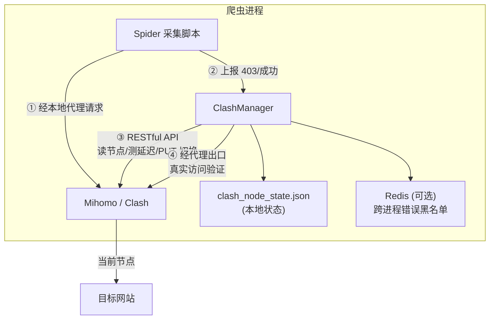

# Clash Proxy

<p align="center">
  
  
  
  
</p>

<p align="center">
  <b>你的机场订阅里有 30 个节点，爬虫只用了 1 个。</b><br>
  剩下 29 个在吃灰 —— 而你的爬虫，正缺代理。
</p>

**clash_proxy 把吃灰的节点管成爬虫代理池**：自动测速、自动轮换、被封自动切换、半夜挂掉自愈。

**关键词**：Clash / Mihomo 代理池 · 机场节点轮换 · 爬虫 IP 轮换 · 反封禁 · 代理池管理器 ·
Clash Verge / Clash for Windows / mihomo 节点管理 · Hysteria2 / Vless / Vmess / Trojan ·
requests / aiohttp / curl_cffi / Playwright 集成 · Python 爬虫代理中间件。

> 核心单文件 · 三行代码接入 · 机场订阅费之外零成本 · 可选扩展（多来源 / 优先度 / 网络体检 / 客户端适配）

**English: [README.en.md](README.en.md)**

---

## 它解决什么问题

做海外采集，代理是三座绕不开的大山。爬虫人的真实日常：

| 😩 你的痛点 | 💸 目前的解法 | ✅ 有了 clash_proxy |
|-------------|---------------|---------------------|
| **代理太贵** — 采几千条数据，商业海外代理却按大规模流量计费，一个月几百上千块 | 咬着牙买流量包，90% 用不完 | 用你**已有的机场节点**，订阅费之外零成本 |
| **封 IP 就断活** — 目标站一封，要么手动去客户端点切换，要么任务挂到天亮 | 人肉盯着 / 写一坨切换脚本 | 连续 3 次 403 **自动切节点**，任务继续跑 |
| **节点好坏全靠蒙** — 机场几十个节点，哪个能用？哪个快？哪个已经被封？ | 挨个手动测，换一个试一个 | 全量测速 + 切换前预检 + 切换后真实验证，**只轮换确认能用的** |

**一句话总结**：你买的机场订阅里，藏着一个小型代理池。本项目负责把它开起来。

---

## 一分钟看懂它能干什么

| 能力 | 一句话说明 |
|------|-----------|
| 🔌 **读**节点 | 自动从订阅里挑出真实节点，过滤「剩余流量」「到期时间」「官网推广」等垃圾条目 |
| 📶 **测**节点 | 延迟测试 + 经代理真实访问你的目标站，**并用实测出口 IP 确认切换真的生效** |
| 🔄 **换**节点 | 上报被拒/不通自动切 / 每下载 N 次轮换 / 后台守护自愈 |
| ⚖️ **均衡**负载 | 4 种策略：轮流用、随机、谁被拒少用谁、谁用得少用谁 |
| 🧊 **冷却**自愈 | 失败节点指数冷却后自动回归，不永久拉黑会恢复的节点 |
| 💤 **全池熔断** | 所有出口都失效时静默等待，不继续试探（服务端整体限流由请求速率维持） |
| 🎯 **优先度** | 置顶/拉黑某几个节点、只留某些地区、延迟阈值、优先低倍率线路 |
| 🔌 **多来源** | 节点来自 Clash 策略组 / 静态代理列表（不经 Clash）/ 多个 Clash 实例聚合 |
| 🩺 **体检** | `netcheck` 一屏看完：逐节点延迟、真实出口 IP、目标站判定、独立出口数 |
| 🧩 **一行接入** | requests / aiohttp / curl_cffi / Playwright 适配器，自动带代理 + 切换后自动重建连接 |
| 📊 **看**得见 | `stats` 看每个节点的下载/被拒/冷却；`status` 看运行模式与出口 IP |

## 三行代码接入爬虫

```python
from clash_manager import ClashManager

manager = ClashManager({
    "api_url": "http://127.0.0.1:9097",        # Clash API 地址（见下方「端口对照」）
    "secret": "your-secret",
    "post_switch_test_url": "https://你的目标站/",  # 就填你要采集的站
})

proxies = manager.get_proxy_config()   # 爬虫所有请求走这个
```

> **端口对照** —— 本项目文档里出现的两套端口不是笔误，是两种部署方式：
>
> | 部署方式 | API 端口 | 代理端口 |
> |---|---|---|
> | **本地 Clash 客户端**（Clash Verge 等） | `9097` | `7897` |
> | **Docker 部署 Mihomo**（`docker-compose.yml` 模板） | `9099` | `7777` |
>
> 用哪套取决于你的实例，和代码无关 —— 两个值都是配置项，填对即可。
> 拿不准就 `python clash_cli.py test`，它会告诉你连没连上。

请求处如实上报结果，其余全自动：

```python
try:
    resp = requests.get(url, proxies=proxies, timeout=30)
except requests.RequestException:
    manager.report_verdict("dead")        # 超时/连接被重置 → 该出口链路不通
else:
    if resp.status_code == 200:
        manager.report_verdict("ok")      # 成功：记账 + 修复该节点信誉
    elif resp.status_code in (403, 429):
        manager.report_verdict("blocked") # 拿到响应但被拒 → 攒够次数换节点
```

> **为什么是 `report_verdict` 而不是 `increment_403_error`？**
> 同一个 403，对 A 站是权限不足（跟节点无关），对 B 站才是 IP 被封 —— 判据取决于
> 目标站，不该由库硬编码。`report_verdict` 把三态交给调用方；老代码里的
> `increment_403_error()` / `increment_download_count()` 仍完全可用（前者等价于
> `report_verdict("blocked")`）。
>
> 如果目标站用的是**业务状态码**判封禁（例如 HTTP 200 但 `{"code": 50000}`），
> 直接 `manager.report_verdict("blocked")` 即可，不用管 HTTP 状态码是多少。

### 更省事的写法：一行接入

上面那些「取代理 / 上报 / 切换后重建连接」的样板，`clash_clients.py` 都替你写好了：

```python
from clash_clients import session, aiohttp_session, curl_cffi_session, browser_context

with session(manager) as s:                       # requests
    r = s.get(url)

async with aiohttp_session(manager) as s:         # aiohttp（切换在线程池里跑，不卡事件循环）
    async with s.get(url) as r: ...

with curl_cffi_session(manager, impersonate="chrome") as s:   # TLS 指纹伪装
    r = s.get(url)

async with browser_context(manager) as ctx:       # Playwright（真实 Chrome，非内置 Chromium）
    page = await ctx.new_page()
```

适配器内置三件事：**自动带代理**、**切换节点后自动重建连接**（keep-alive 会复用旧隧道，
这是最容易踩的坑）、**自动上报判定**。

完整写法与选型见 [docs/http-clients.md](docs/http-clients.md)（HTTP 库）
与 [docs/browser-clients.md](docs/browser-clients.md)（浏览器）。

---

## 为什么不用商业代理池？

| | 💰 商业海外代理池 | ✈️ 机场节点 + clash_proxy |
|--|------------------|--------------------------|
| 月成本 | 几百 ~ 上千元 | **0**（订阅费之外） |
| 适用量级 | 每秒上百请求的大规模采集 | **少量数据采集**（学术文献、公开数据、新闻、API） |
| 接入成本 | 学习各家 SDK、按流量对账 | 一个文件，三行代码 |
| 节点来源 | 服务商分配，不可控 | 你自己的订阅，随时加节点 |

**诚实声明**：机场节点带宽有限，本项目不适用于每秒上百请求的重型采集。
但如果你要采的是几万条文献、几万条公开数据——商业代理池是杀鸡用牛刀，
吃灰的机场节点刚刚好。

> 本项目已在真实海外文献采集项目中长期运行：数百次自动切换、数十个节点
> 全托管、任务全程无人值守。

---

## 架构



---

## 快速开始

### 前提

- Python 3.8+
- 一个 Clash / Mihomo 实例（本地 Clash 客户端，或 Docker 部署）
- 一份机场订阅（或自建节点）
- 可选：Redis（跨进程共享错误黑名单）

### 方式一：使用本地 Clash 客户端（最简单）

Windows/macOS 的 Clash Verge / Clash for Windows 等客户端都内置了 RESTful API：

1. 打开客户端的「允许局域网访问/Allow LAN」并记下端口（Clash Verge 默认 `7897`，Clash for Windows 默认 `7890`）；
2. 在客户端「设置 → 外部控制」找到 API 端口（一般 `9090`）和密钥（secret）；
3. 安装依赖并验证：

```bash
pip install requests redis   # redis 可选

export CLASH_API_URL="http://127.0.0.1:9090"   # 你客户端的 API 端口
export CLASH_PROXY_PORT="7897"                 # 你客户端的代理端口
export CLASH_SECRET="你的密钥"

python clash_cli.py test
# [✅] Clash API 可达
# [✅] 代理出口可用 → ...
```

### 方式二：Docker 部署 Mihomo（推荐用于服务器）

```bash
# 1. 准备订阅配置
cp config/config.example.yaml config/config.yaml
#    把订阅内容粘贴进 config.yaml 的 proxies / proxy-groups 段
#    或使用脚本从订阅文件同步:
#    CLASH_CONFIG_SOURCE=/path/to/sub.yaml ./scripts/sync_config.sh your-secret

# 2. 下载地理数据库（可选）
#    见 config/README.md

# 3. 启动
docker compose up -d

# 4. 验证
cp .env.example .env   # 修改 secret 为 your-secret
python clash_cli.py test
```

---

## CLI 使用

```bash
python clash_cli.py list          # 列出所有节点 + 健康状态
python clash_cli.py switch        # 切换节点(按当前策略)
python clash_cli.py switch --random
python clash_cli.py switch --strategy least_403
python clash_cli.py status        # 当前状态（含运行模式、出口 IP、冷却中的节点）
python clash_cli.py stats         # 各节点负载统计(下载/被拒/冷却)
python clash_cli.py health        # 全量测延迟
python clash_cli.py test          # API + 代理出口连通性
python clash_cli.py monitor       # 后台健康守护(每 30s 巡检)

python clash_cli.py netcheck      # 网络体检: 逐节点延迟 / 真实出口 IP / 目标站判定
python clash_cli.py netcheck --no-exit-ip          # 跳过出口 IP（快，且不切节点）
python clash_cli.py netcheck --probe 'POST:https://api.x.com/gen|code=50000'

python clash_cli.py priority --pin "🇸🇬 新加坡-示例01"    # 钉住可用节点
python clash_cli.py priority --block "🇭🇰 香港01" --list          # 拉黑 + 查看
```

环境变量可写入项目根目录 `.env` 文件（见 [.env.example](.env.example)）。

---

## 配置项说明

| 参数 | 默认值 | 说明 |
|------|--------|------|
| `api_url` | `http://127.0.0.1:9097` | Clash 外部控制地址（`clash_cli.py` 走环境变量 `CLASH_API_URL`，默认 `9099`） |
| `secret` | `your-secret-here` | API 密钥，与 config.yaml 一致 |
| `group_name` | `🚀节点选择` | 节点所在策略组（Selector）名；填错会自动发现 |
| `proxy_port` | `7897` | 本地代理端口（`clash_cli.py` 默认 `7777`，对应 Docker 模板） |
| `post_switch_test_url` | **必填** | 切换后连通性检测 URL，**建议填实际采集的目标站**（按站点隔离错误黑名单） |
| `switch_strategy` | `round_robin` | 负载均衡策略：`round_robin` / `random` / `least_403` / `least_used` |
| `max_downloads_per_node` | `500` | 每节点最大下载次数，达到即轮换 |
| `max_403_errors` | `3` | 累计多少次被拒（403）触发切换 |
| `post_switch_timeout_sec` | `5` | 出口连通性检测超时 |
| `post_switch_max_retries` | `3` | 切换尝试的候选节点数上限 |
| `pre_switch_delay_check` | `true` | 切换前用 API 测候选节点延迟，跳过不可用节点 |
| `require_post_switch_connectivity` | `true` | 切换后必须经代理出口真实访问外网才确认成功 |
| `only_use_verified_nodes` | `true` | 只在已验证节点池内轮换 |
| `state_file` | `clash_node_state.json` | 状态持久化文件路径 |
| `show_node_info` | `true` | 启动时打印节点列表 |

**出口校验 / 冷却（v2 新增，强烈建议保持默认）**

| 配置项 | 默认 | 说明 |
|--------|------|------|
| `verify_exit_ip` | `true` | 切换前后各查一次**真实出口 IP**并比对。这是唯一能识破"切换没生效"的判据（见下方 FAQ） |
| `exit_ip_url` | `https://api.ipify.org` | 出口 IP 查询地址，可换成国内可达的服务 |
| `exit_ip_timeout_sec` | `8` | 出口 IP 查询超时 |
| `allow_same_exit_ip` | `false` | 少数机场多个节点共用同一出口 IP，这类情况设为 `true` 才不会被判为"切换未生效" |
| `exit_ip_log_file` | `""` | 非空则把「时间 / 节点 / 出口 IP」追加写入该 TSV，便于事后溯源 |
| `force_global_mode` | `false` | 启动时自动切到 global 模式（`restore_mode()` 可还原）。**rule 模式下切策略组对流量无效** |
| `cooldown_base_sec` | `120` | 节点失败后的首次冷却秒数，之后指数增长 |
| `cooldown_max_sec` | `7200` | 冷却上限（2 小时） |
| `health_check_workers` | `8` | 健康检测并发上限。**别设成节点数**——几十个节点同时打目标站会触发服务端限流 |
| `health_check_url` | 同 `post_switch_test_url` | 延迟测试/健康检测的探测 URL，默认就是目标站（**不要**改成 gstatic 之类的通用地址） |
| `health_check_timeout_ms` | `10000` | 延迟测试超时（目标站是重页面时 5s 会误杀好节点） |

**代理来源（可选扩展 `clash_sources.py`）**

| 配置项 | 默认 | 说明 |
|--------|------|------|
| `source` | 无 | 代理来源。不给就走原来的 Clash 策略组路径。支持传 `ProxySource` 对象，或 `{"type": "static", "file": "proxies.txt"}` / `{"type": "clash", ...}` |
| `sources` | 无 | 来源列表，多个 Clash 实例会被聚合为一个池 |

**节点优先度（可选扩展 `clash_policy.py`）**

| 配置项 | 默认 | 说明 |
|--------|------|------|
| `policy.pin_nodes` | `[]` | 置顶节点（绕过轮换，优先使用） |
| `policy.block_nodes` | `[]` | 拉黑节点（不进候选） |
| `policy.prefer_regions` | `[]` | 偏好地区，如 `["新加坡", "日本"]`（从节点名/国旗解析） |
| `policy.exclude_regions` | `[]` | 排除地区 |
| `policy.max_latency_ms` | 无 | 延迟上限；未知延迟的节点放行 |
| `policy.prefer_low_multiplier` | `false` | 按流量倍率排序（识别「0.1倍」这类写法） |
| `policy.priority_file` | `<state_file>.priority.json` | 置顶/拉黑的持久化文件（**独立存储**，不能混进 state_file） |

**其他**

| 配置项 | 默认 | 说明 |
|--------|------|------|
| `pool_exhausted_wait_sec` | `3600` | 所有出口都在冷却时的静默等待秒数。0 = 关闭该行为。**别调小**：服务端整体限流由聚合请求速率维持，继续试探只会延长它（实测静默 1-2 小时后自行恢复） |
| `extra_invalid_patterns` | `[]` | 额外的节点名过滤词。有些机场的推广条目会伪装成正常节点（如 Vless 类型的「1.永久官网《xxx.io》」），内置词表拦不住时补在这里。**加词要克制**：单用「流量」会把含「流量倍率」的真实节点全部误杀 |

---

## 核心机制（生产踩坑沉淀）

1. **三重验证切换** — 仅 API 返回 204 不代表节点真能上网，更不代表**流量真的换了出口**：
   ① 切换前用 API 测候选延迟，跳过明显不可用的；
   ② 切换后经代理真实访问目标站（**拿到任何 HTTP 响应即算可达** —— 风控站上 403 往往代表节点正常，当成"不通"会误杀好节点）；
   ③ 再查一次**实测出口 IP**，必须与切换前不同才认成功。
2. **指数冷却而非永久拉黑** — 节点失败冷却 `120s × 2ⁿ`（封顶 2 小时）后自动回归。节点失败大多会自愈（IP 限流实测约 1 小时恢复），永久拉黑等于白白损失会恢复的节点。
3. **错误黑名单按站点隔离** — Redis key 含目标站域名：A 站封的节点不影响 B 站使用。
4. **误杀保护** — 错误节点数与总节点数接近时自动清空黑名单，防止「全军覆没」死锁。
5. **订阅元数据过滤** — 过滤「剩余流量」「到期时间」等条目；注意不能用单独的「流量」二字过滤，节点名常含「流量倍率」会误杀全部线路。
6. **健康检测限并发** — 默认最多 8 个并发。几十个节点同时打同一个目标站，单看每个都很温和，但**聚合速率足以触发服务端整体限流**。
7. **状态文件加锁 + 合并写** — 多进程共享 `state_file` 时逐键取大值合并，不会「后写的把前者的节点信誉整体覆盖掉」。
8. **上报判据交给调用方** — `report_verdict("ok"/"blocked"/"dead")` 三态。同一个 403，对 A 站是权限不足、对 B 站才是 IP 被封，不该由库硬编码。

---

## 目录结构

```
clash_proxy/
├── clash_manager.py          # 核心: ClashManager(单文件, 无框架依赖)
├── clash_cli.py              # CLI 工具（9 个子命令）
│
│   ── 以下为可选扩展模块：删掉它们，上面两个依然完整可用 ──
├── clash_sources.py          # 可插拔代理来源（Clash 策略组 / 静态列表 / 多实例聚合）
├── clash_policy.py           # 节点优先度（置顶/拉黑/地区/延迟/倍率）
├── clash_probe.py            # 目标站探针、逐节点出口 IP、网络体检
├── clash_clients.py          # requests / aiohttp / curl_cffi / Playwright 适配器
│
├── docker-compose.yml        # Mihomo Docker 部署
├── pyproject.toml            # 打包元数据（可 pip install .）
├── requirements.txt          # 依赖（核心只有 requests）
├── AGENTS.md                 # 给 AI 编码 agent 的项目约定与改动指引
├── llms.txt                  # 给 LLM 的策展文档索引（llmstxt.org 规范）
├── config/
│   ├── config.example.yaml   # Clash 配置示例(脱敏, 带讲解注释)
│   └── README.md             # 配置文件/地理数据库说明
├── scripts/
│   └── sync_config.sh        # 从订阅文件同步配置
├── tests/
│   ├── sources_test.py       # 离线单测（不联网、不需要 Clash，可进 CI）
│   ├── smoke_test.py         # 冒烟自检（只读，不切节点，可安全在采集期间跑）
│   └── switch_live_test.py   # 真实切换测试（会切节点，需另起一个 Clash 实例）
└── docs/
    ├── README.md             # 文档索引（从这里进）
    ├── quickstart.md         # 从零到一教程
    ├── config-guide.md       # Clash 配置文件讲解（字段/导入方式/常见坑）
    ├── logic.md              # ClashManager 逻辑介绍（切换状态机/冷却/线程安全）
    ├── http-clients.md       # 搭配 requests / curl_cffi / aiohttp 用法大全
    └── browser-clients.md    # 搭配 Playwright / Selenium 用法大全（含实战踩坑）
```

**自检**：改完配置或怀疑代理池有问题时，先跑冒烟测试（**只读、不切节点**，采集跑着也能安全执行）：

```bash
# Windows (cmd)
set CLASH_API_URL=http://127.0.0.1:9097
set CLASH_SECRET=your-secret
set CLASH_PROXY_PORT=7897
set CLASH_TEST_URL=https://你的目标站/
python tests/smoke_test.py

# Linux / macOS (bash) —— 同一件事
export CLASH_API_URL="http://127.0.0.1:9097"
export CLASH_SECRET="your-secret"
export CLASH_PROXY_PORT="7897"
export CLASH_TEST_URL="https://你的目标站/"
python tests/smoke_test.py
```

想验证「切换到底有没有真的换出口」，跑 `tests/switch_live_test.py`。它会**真的切节点**，
所以建议另起一个 Clash 实例（换端口）跑，别打在正在采集的实例上。它会依次验证：
正常切换后出口 IP 确实变化 → 冷却机制生效 → **rule 模式下切换被正确识破并拒绝**。

## 文档导航

**完整索引见 [docs/README.md](docs/README.md)**（含 `config/README.md`、`AGENTS.md`、`CHANGELOG.md` 等非 `docs/` 下的文档）。

| 文档 | 内容 |
|------|------|
| [docs/quickstart.md](docs/quickstart.md) | 从零到一：部署 → 订阅 → 第一个采集脚本 |
| [docs/config-guide.md](docs/config-guide.md) | Clash 配置文件逐字段讲解、订阅导入三种方式、常见坑 |
| [docs/logic.md](docs/logic.md) | ClashManager 内部逻辑：切换状态机、三重验证、冷却机制 |
| [docs/http-clients.md](docs/http-clients.md) | 代理池搭配 requests / curl_cffi / aiohttp 的完整写法 |
| [docs/browser-clients.md](docs/browser-clients.md) | 代理池搭配 Playwright / Selenium：切换节点后如何生效、反检测清单、实战踩坑 |
| [AGENTS.md](AGENTS.md) | 给 AI 编码 agent：项目约定、改动指引、「最贵的几条经验」 |
| [llms.txt](llms.txt) | 给 LLM 的策展文档索引（[llmstxt.org](https://llmstxt.org) 规范） |
| [CHANGELOG.md](CHANGELOG.md) | 版本变更记录 |
| [CONTRIBUTING.md](CONTRIBUTING.md) | 如何参与开发、测试怎么跑、代码约定 |
| [SECURITY.md](SECURITY.md) | 安全注意事项（端口暴露、凭证管理、使用边界） |

---

## FAQ

**Q: 必须用 Docker 吗？**
不用。任何带 RESTful API 的 Clash/Mihomo 实例都可以：本地 Clash Verge、软路由、服务器上的 Clash 都行，改 `api_url` / `proxy_port` 即可。

**Q: 为什么建议 `post_switch_test_url` 填目标站？**
错误黑名单按该域名隔离；同时切换后验证的就是「这个节点能不能访问你的目标站」，比通用的 204 检测更可靠。

**Q: 日志说切换成功了，但我觉得一直在用同一个出口？**
这种"静默 no-op"正是 `verify_exit_ip`（默认开）要拦的，它会在切换前后各查一次真实
出口 IP 并比对。两个高频原因：

1. **Clash 处于 rule 模式** —— 流量按规则链走，`PUT /proxies/<组>` 只改了组的 `now`，
   对实际流量毫无影响。要按节点轮换出口，必须处于 **global 模式**（此时 `GLOBAL` 组
   即实际出口）。设 `force_global_mode: true` 让库在启动时自动切过去。
2. **keep-alive 复用旧连接** —— mihomo 按连接选出口，切换前建立的连接仍走旧节点。
   重新建连（新 Session / `Connection: close` / 页面 reload）才会走新出口。

另：少数机场存在**多个节点共用同一出口 IP**（例如同一台机器的不同协议入口），
这种情况设 `allow_same_exit_ip: true`。

**Q: 需要把 Node 数设成健康检测并发数吗？**
不要。`health_check_workers` 默认 8，刻意留了上限：几十个节点同时对同一个目标站
发请求，单看每个都很温和，但**聚合速率足以触发服务端整体限流**（风控看的是总速率，
不是单请求）。

**Q: 节点被封了就永久不能用了吗？**
不是。节点失败进入 **指数冷却**（`cooldown_base_sec` × 2ⁿ，封顶 `cooldown_max_sec`），
冷却结束会自动重新参与轮换。实测 IP 限流大多在 1 小时左右自愈，永久拉黑会白白
损失会恢复的节点。

**Q: 节点全被拉黑了怎么办？**
不会死锁：黑名单数量与节点总数接近时自动清空；切换失败还会走全量扫描兜底。

**Q: Redis 一定要装吗？**
不必。未安装时错误黑名单自动降级为进程内内存，单进程采集完全够用；多进程共享黑名单才需要。

**Q: 大规模采集适用吗？**
不适用。机场节点带宽有限，本工具定位是「少量数据 + 有限节点」；大规模采集请用商业代理池。

---

## 安全提示

- 切勿把含真实节点的 `config/config.yaml` 提交到仓库（已加入 .gitignore）；
- 代理端口与 API 端口默认仅监听 `127.0.0.1`，不要暴露到公网；
- 请遵守目标网站的 robots.txt 与当地法律法规。

## License

[MIT](LICENSE) © Jimmy Smile
