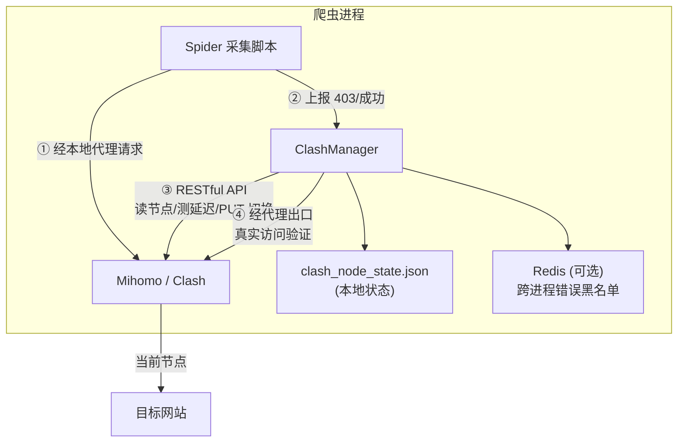

# Clash Proxy — 机场节点代理池管理器

<p align="center">
  
  
  
  
</p>

> 把机场订阅里「用不完的节点」变成爬虫的代理池：节点读取、测速、健康检测、负载均衡、失败自动切换，一个文件全搞定。

**English: [README.en.md](README.en.md)**

---

## 为什么需要它？（使用场景）

做海外数据采集时，代理是最让人头疼的成本之一：

- **企业级海外代理**（住宅 IP / 机房代理池）：按流量计费，动辄几千元/月，采集少量数据纯属浪费；
- **机场订阅**：几十块钱/月就有十几到几十个节点，但多数人只用其中一两个——剩下 90% 的节点在闲置。

**本项目解决的就是这个问题**：当你的采集任务只需要少量数据（学术文献、公开数据、国外新闻、API 数据等），用机场的少量节点就完全够用。Clash Proxy 帮你把这些节点管起来：

| 能力 | 说明 |
|------|------|
| 🔌 节点读取 | 从 Clash 策略组拉取全部节点，自动过滤订阅元数据（"剩余流量""到期"等）、嵌套策略组、不支持的类型 |
| 📶 节点测试 | Clash API 延迟测试 + 经代理出口真实访问目标站，**双重验证** |
| 🔄 节点轮换 | 下载计数 / 403 计数触发自动切换，四种负载均衡策略 |
| ⚖️ 负载均衡 | `round_robin`（轮询）/ `random`（随机）/ `least_403`（403 最少的优先）/ `least_used`（使用最少的优先） |
| 🛡️ 节点管理 | 已验证节点池、错误节点黑名单（**按站点隔离**）、误杀保护、健康守护线程 |
| 💾 状态持久化 | 本地 JSON 状态 + 可选 Redis 跨进程共享黑名单 |

> ⚠️ **边界**：本项目不是代理池服务（不提供 IP），也不做并发拨号。它管理的是**机场订阅里的有限节点**，适合「少量数据 + 有限节点」的场景；如果需要每秒上百请求的大规模采集，请使用商业代理池。

---

## 架构

```
┌───────────────── 爬虫进程 ─────────────────┐
│  Spider                                       │
│    │ ① 经本地代理请求目标站                    │
│    │ ② 403/成功 → 通知 ClashManager           │
│    ▼                                          │
│  ClashManager ──── RESTful API 直连 ────┐    │
│    │ ③ 读取/测速/切换节点               │    │
│    │ ④ 双重验证(延迟+真实出口)           │    │
│    ▼                                    ▼    │
│  clash_node_state.json         Mihomo(Clash) │
│  (本地状态/验证池)               │ 代理端口    │
│  Redis(可选,跨进程黑名单)         ▼            │
└────────────────────────────── 机场节点池 ────┘
                                       │
                                       ▼
                                  目标网站
```



---

## 快速开始

### 前提

- Python 3.8+
- 一个 Clash / Mihomo 实例（本地 Clash 客户端，或 Docker 部署）
- 一份机场订阅（或自建节点）
- 可选：Redis（跨进程共享错误黑名单）

### 方式一：使用本地 Clash 客户端（最简单）

Windows/macOS 的 Clash Verge / Clash for Windows 等客户端都内置了 RESTful API：

1. 打开客户端的「允许局域网访问/Allow LAN」并记下端口（Clash Verge 默认 `7897`，Clash for Windows 默认 `7890`）；
2. 在客户端「设置 → 外部控制」找到 API 端口（一般 `9090`）和密钥（secret）；
3. 安装依赖并验证：

```bash
pip install requests redis   # redis 可选

export CLASH_API_URL="http://127.0.0.1:9090"   # 你客户端的 API 端口
export CLASH_PROXY_PORT="7897"                 # 你客户端的代理端口
export CLASH_SECRET="你的密钥"

python clash_cli.py test
# [✅] Clash API 可达
# [✅] 代理出口可用 → ...
```

### 方式二：Docker 部署 Mihomo（推荐用于服务器）

```bash
# 1. 准备订阅配置
cp config/config.example.yaml config/config.yaml
#    把订阅内容粘贴进 config.yaml 的 proxies / proxy-groups 段
#    或使用脚本从订阅文件同步:
#    CLASH_CONFIG_SOURCE=/path/to/sub.yaml ./scripts/sync_config.sh your-secret

# 2. 下载地理数据库（可选）
#    见 config/README.md

# 3. 启动
docker compose up -d

# 4. 验证
cp .env.example .env   # 修改 secret 为 your-secret
python clash_cli.py test
```

---

## 爬虫集成（核心用法）

```python
from clash_manager import ClashManager

manager = ClashManager({
    "api_url": "http://127.0.0.1:9099",
    "secret": "your-secret",
    "group_name": "🚀节点选择",            # 订阅里节点所在的策略组
    "proxy_port": 7777,                     # 本地代理端口
    "post_switch_test_url": "https://目标网站/",  # 重要: 填你实际要采集的站
    "switch_strategy": "least_403",         # 负载均衡策略
    "max_downloads_per_node": 500,          # 每个节点最多下载 500 次
})

# 所有请求都走本地代理
proxies = manager.get_proxy_config()  # {"http": "http://127.0.0.1:7777", ...}

for url in url_list:
    resp = requests.get(url, proxies=proxies, timeout=30)

    if resp.status_code == 403:
        # 被目标站封了: 累计 3 次自动切换节点
        manager.increment_403_error()
    elif resp.status_code == 200:
        # 下载成功: 计数, 每节点满 500 次轮换(负载均衡)
        manager.increment_download_count()
        save(resp.content)

# 可选: 启动后台守护, 节点中途挂掉自动切换
manager.start_auto_health_check(interval_sec=30)
```

多线程场景下所有方法都是线程安全的（切换操作内部加锁排队）。

---

## CLI 使用

```bash
python clash_cli.py list          # 列出所有节点 + 健康状态
python clash_cli.py switch        # 切换节点(按当前策略)
python clash_cli.py switch --random
python clash_cli.py switch --strategy least_403
python clash_cli.py status        # 当前状态
python clash_cli.py stats         # 各节点负载统计(下载/403 次数)
python clash_cli.py health        # 全量测延迟
python clash_cli.py test          # API + 代理出口连通性
python clash_cli.py monitor       # 后台健康守护(每 30s 巡检)
```

环境变量可写入项目根目录 `.env` 文件（见 [.env.example](.env.example)）。

---

## 配置项说明

| 参数 | 默认值 | 说明 |
|------|--------|------|
| `api_url` | `http://127.0.0.1:9097` | Clash 外部控制地址 |
| `secret` | `"1"` | API 密钥，与 config.yaml 一致 |
| `group_name` | `自动选择` | 节点所在策略组（Selector）名；填错会自动发现 |
| `proxy_port` | `7897` | 本地代理端口 |
| `post_switch_test_url` | **必填** | 切换后连通性检测 URL，**建议填实际采集的目标站**（按站点隔离错误黑名单） |
| `switch_strategy` | `round_robin` | 负载均衡策略：`round_robin` / `random` / `least_403` / `least_used` |
| `max_downloads_per_node` | `500` | 每节点最大下载次数，达到即轮换 |
| `max_403_errors` | `3` | 累计多少次 403 触发切换 |
| `post_switch_timeout_sec` | `5` | 出口连通性检测超时 |
| `post_switch_max_retries` | `3` | 切换尝试的候选节点数上限 |
| `pre_switch_delay_check` | `true` | 切换前用 API 测候选节点延迟，跳过不可用节点 |
| `require_post_switch_connectivity` | `true` | 切换后必须经代理出口真实访问外网才确认成功 |
| `only_use_verified_nodes` | `true` | 只在已验证节点池内轮换 |
| `state_file` | `clash_node_state.json` | 状态持久化文件路径 |
| `show_node_info` | `true` | 启动时打印节点列表 |

---

## 核心机制（生产踩坑沉淀）

1. **双重验证切换** — 仅 API 返回 204 不代表节点真能上网。切换后必须经本地代理出口真实访问目标站（200/204）才算成功，否则立即换下一个候选。
2. **错误黑名单按站点隔离** — Redis key 含目标站域名：A 站封的节点不影响 B 站使用。
3. **误杀保护** — 错误节点数与总节点数接近时自动清空黑名单，防止「全军覆没」死锁。
4. **订阅元数据过滤** — 过滤「剩余流量」「到期时间」等条目；注意不能用单独的「流量」二字过滤，节点名常含「流量倍率」会误杀全部线路。
5. **切换前延迟预检** — 先用 API 测候选节点延迟，跳过明显不可用的，避免白等 set_node + sleep。

---

## 目录结构

```
clash_proxy/
├── clash_manager.py          # 核心: ClashManager(单文件, 约700行)
├── clash_cli.py              # CLI 工具
├── docker-compose.yml        # Mihomo Docker 部署
├── .env.example              # 环境变量模板
├── config/
│   ├── config.example.yaml   # Clash 配置示例(脱敏)
│   └── README.md             # 配置文件/地理数据库说明
├── scripts/
│   └── sync_config.sh        # 从订阅文件同步配置
└── docs/
    ├── quickstart.md         # 从零到一教程
    ├── config-guide.md       # Clash 配置文件讲解（字段/导入方式/常见坑）
    ├── logic.md              # ClashManager 逻辑介绍（切换状态机/黑名单/线程安全）
    └── http-clients.md       # 搭配 requests / curl_cffi / aiohttp 用法大全
```

## 文档导航

| 文档 | 内容 |
|------|------|
| [docs/quickstart.md](docs/quickstart.md) | 从零到一：部署 → 订阅 → 第一个采集脚本 |
| [docs/config-guide.md](docs/config-guide.md) | Clash 配置文件逐字段讲解、订阅导入三种方式、常见坑 |
| [docs/logic.md](docs/logic.md) | ClashManager 内部逻辑：切换状态机、双重验证、黑名单机制 |
| [docs/http-clients.md](docs/http-clients.md) | 代理池搭配 requests / curl_cffi / aiohttp 的完整写法 |

---

## FAQ

**Q: 必须用 Docker 吗？**
不用。任何带 RESTful API 的 Clash/Mihomo 实例都可以：本地 Clash Verge、软路由、服务器上的 Clash 都行，改 `api_url` / `proxy_port` 即可。

**Q: 为什么建议 `post_switch_test_url` 填目标站？**
错误黑名单按该域名隔离；同时切换后验证的就是「这个节点能不能访问你的目标站」，比通用的 204 检测更可靠。

**Q: 节点全被拉黑了怎么办？**
不会死锁：黑名单数量与节点总数接近时自动清空；切换失败还会走全量扫描兜底。

**Q: Redis 一定要装吗？**
不必。未安装时错误黑名单自动降级为进程内内存，单进程采集完全够用；多进程共享黑名单才需要。

**Q: 大规模采集适用吗？**
不适用。机场节点带宽有限，本工具定位是「少量数据 + 有限节点」；大规模采集请用商业代理池。

---

## 安全提示

- 切勿把含真实节点的 `config/config.yaml` 提交到仓库（已加入 .gitignore）；
- 代理端口与 API 端口默认仅监听 `127.0.0.1`，不要暴露到公网；
- 请遵守目标网站的 robots.txt 与当地法律法规。

## License

[MIT](LICENSE) © Jimmy Smile
