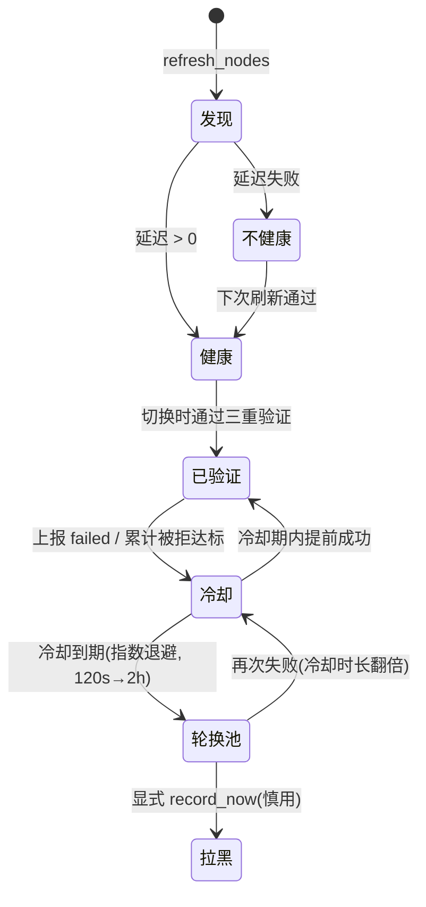

# ClashManager 逻辑介绍

本文介绍 `clash_manager.py` 的内部工作机制，帮助你理解为什么节点切换
可靠、以及出问题时如何排查。适合想在源码基础上二次开发的读者。

---

## 1. 整体数据流

```
                    ┌──────────────────────────────────────────┐
                    │              爬虫进程                     │
                    │                                          │
  url_list ──────►  │  Spider ──代理流量(127.0.0.1:7777)────┐   │
                    │     │                                  │   │
                    │     │ 上报成功/403/异常                 │   │
                    │     ▼                                  ▼   │
                    │  ClashManager ◄──RESTful API 直连── Mihomo │
                    │     │                    (读节点/测延迟/PUT) │
                    │     ▼                                      │
                    │  本地状态 clash_node_state.json            │
                    │  可选 Redis 错误黑名单(跨进程)              │
                    └──────────────────────────────────────────┘
```

要点：

- **代理流量与管理流量分离**：爬虫请求走 7777 代理端口；ClashManager
  通过 API 端口直连 Mihomo（内部会临时禁用环境代理变量，避免「用代理
  访问代理自己的 API」导致 502）。
- **ClashManager 从不代理任何请求**：它只负责「决定当前用哪个节点」。
  爬虫的每个请求经 Mihomo 出口时，用的就是当前策略组选中的节点。

---

## 2. 启动流程

`ClashManager(config)` 初始化时依次做：

```text
load_state()          从 clash_node_state.json 恢复: 当前节点索引、下载计数、
                      per-node 统计、已验证节点池、冷却表
        │
        ▼
ensure_global_mode()  (force_global_mode=True 时) 切到 global 模式并记住原模式
        │
        ▼
refresh_nodes()       经 API 读取策略组节点列表:
                      过滤订阅元数据(剩余流量/到期等) → 过滤嵌套策略组
                      → 过滤不支持类型 → 过滤错误黑名单
        │
        ▼
refresh_node_health() 线程池并发测全部节点延迟, 标记 healthy/unhealthy
                      (并发度受 health_check_workers 限制, 默认 8)
```

失败不抛异常：API 连不上只是打日志，爬虫代码可以照常运行
（`enable_node_switching=False` 时可完全跳过）。

> **模式检查**：启动时会读一次 `/configs` 的 `mode`。若为 rule 模式，
> 会明确警告「切策略组不改变实际出口」——这是最常见的"切换没生效"原因。

---

## 3. 节点生命周期



三个核心集合：

| 集合 | 存储位置 | 含义 |
|------|----------|------|
| `verified_nodes` | clash_node_state.json | 曾经通过「三重验证」的节点名，优先轮换池 |
| `node_cooldowns` | clash_node_state.json | 节点名 → 冷却截止时间戳；选节点时自动跳过 |
| `error_node_set`（黑名单） | Redis(可选)/内存 | 显式拉黑的节点名，refresh_nodes 时直接排除 |

> **冷却 vs 拉黑**：拉黑是永久的，而节点失败大多会自愈（IP 限流实测约 1 小时
> 恢复）。所以默认路径是**指数冷却**（`cooldown_base_sec` × 2ⁿ，封顶
> `cooldown_max_sec`），冷却结束自动回到轮换池；只有你明确调用
> `switch_to_healthy_node(record_now=True)` 才会进永久黑名单。

---

## 4. 切换流程（核心状态机）

`switch_node()` → `_perform_switch()` 的完整流程：

```text
触发切换(手动/403计数/下载计数/健康守护)
  │
  ├─ 2. 选定候选列表
  │     有已验证节点 → 按 switch_strategy 排序 verified 池     (mode=verified_only)
  │     无已验证节点 → 全量扫描构建验证池                       (mode=build_pool)
  │
  ├─ 1. 记录切换前出口 IP(get_exit_ip, verify_exit_ip=True 时)
  │
  ├─ 3. 逐个尝试候选 (最多 post_switch_max_retries 个)
  │     │
  │     ├─ 预检: API 测候选节点延迟, 测不通直接跳过 ⏭️
  │     │        (pre_switch_delay_check, 默认开)
  │     │
  │     ├─ PUT /proxies/{group} {"name": 候选}   → 204 只是"收到指令"
  │     │
  │     ├─ 验证1: 轮询 GET /proxies/{group}, now == 候选?   (最多3次)
  │     │
  │     ├─ 验证2: 经代理出口真实请求 post_switch_test_url
  │     │        拿到任何 HTTP 响应即算可达 (超时/连接错误才判不通)
  │     │
  │     └─ 验证3: 再查一次出口 IP, 必须与切换前**不同**
  │              │
  │              ├─ 全部通过 → 加入 verified_nodes, 重置计数, 保存状态 ✅
  │              └─ 任一失败 → 从 verified_nodes 移除, 尝试下一个候选 ⏭️
  │
  └─ 全部失败 → 返回 False(爬虫自行决定重试/暂停)
```

**为什么需要验证2**：`PUT` 返回 204 只代表 Mihomo 接受了指令；节点可能欠费、
被墙、线路故障。只有真实发出请求拿到响应，才能确认「这个节点此刻能访问你的
目标站」。

> ⚠️ 验证2 的判据是「**拿到了 HTTP 响应**」，不是「状态码是 200」。
> 风控站点上 403 往往恰恰代表**节点正常且可达**（例如请求参数不合法）。
> 把 403 当作"节点不通"会把好节点踢出已验证池。

**为什么需要验证3（出口 IP 校验）**：前两步都通过、出口却纹丝不动的情况
真实存在，且**完全静默**：

| 场景 | 现象 |
|------|------|
| Clash 处于 **rule 模式** | 流量按规则链走，`PUT /proxies/<组>` 只改了组的 `now`，对流量是 no-op |
| **keep-alive 复用旧连接** | mihomo 按连接选出口，旧连接继续走旧节点 |

两者都会让 `now == 候选` 和「能访问目标站」同时成立 —— 因为**目标站本来就能
访问，只是走的还是老出口**。唯一可靠的判据是实测出口 IP。

**预检的意义**：每个候选节点验证失败要花 `3s 等待 + 最多3次轮询`，
如果候选本身延迟就测不通，预检能直接跳过，避免几十秒的无谓等待。

---

## 5. 四种切换触发方式

| 触发 | 调用 | 条件 | 典型场景 |
|------|------|------|----------|
| 手动 | `switch_node()` / `switch_to_healthy_node()` | 立即 | CLI、任务开始前主动换 |
| 上报被拒 | `report_verdict("blocked")` | 累计 `max_403_errors`(默认3)次 | 目标站封 IP / 业务风控码 |
| 上报不通 | `report_verdict("dead")` | 立即冷却 + 累计达阈值切换 | 超时、连接重置 |
| 下载计数 | `increment_download_count()` | 单节点满 `max_downloads_per_node`(默认500) | 主动轮换摊流量 |
| 健康守护 | `start_auto_health_check()` 后台线程 | 每 interval 秒出口检测失败 | 长时间运行自愈 |

被拒计数是「连续」的：一次成功就会 `reset_403_error()` 清零，避免历史累积误触发。

**`report_verdict` 与旧接口的关系**：

| verdict | 行为 |
|---------|------|
| `"ok"` | 记账 + `mark_node_ok()`（清冷却、衰减该节点 403 计数） |
| `"blocked"` | 该节点 403 计数 +1；**累计到 `max_403_errors` 才冷却该节点**（单次 403 可能只是缺 header，不该一棒打死）；全局计数达阈值则切换 |
| `"dead"` | 立即 `mark_node_failed()` 冷却该节点；全局计数达阈值则切换 |

`increment_403_error()` 保留为 `report_verdict("blocked")` 的别名。

---

## 6. 负载均衡策略

候选列表排序逻辑（`_order_by_strategy`）：

| 策略 | 行为 | 依赖数据 |
|------|------|----------|
| `round_robin` | 从当前节点之后顺序轮转 | 无 |
| `random` | 随机打乱 | 无 |
| `least_403` | 403 历史最少的节点优先 | `node_403_counts` |
| `least_used` | 下载次数最少的节点优先 | `node_download_counts` |

per-node 统计在上报时累计，随 `save_state()` 持久化，重启不丢。
用 `clash_cli.py stats` 可以直观看到各节点负载。

> **403 计数必须衰减**：`mark_node_ok()` 会把该节点的 403 计数 -1。没有这个衰减，
> `least_403` 跑久了会退化成「永远选那几个历史清零的节点」，哪怕它们现在早就
> 坏了——因为计数只增不减，坏节点早晚也会被选上并继续累加，而"干净"的节点
> 一旦变坏就再也追不上。

> 策略只在「候选列表」内排序。默认 `only_use_verified_nodes=True` 时，
> 候选列表是已验证节点池——即先保证「能用」，再谈「均衡」。
> 冷却中的节点不进入候选（`get_healthy_nodes()` 已过滤）。

---

## 7. 错误黑名单（按站点隔离）

```python
web_loc = urlparse(self.post_switch_test_url).netloc.replace(".", "_")
self.error_node_set = _ErrorNodeStore(f"clash_error_node_set_{web_loc}")
```

- 黑名单 key 带目标站域名：**A 站封的节点不影响 B 站**；
- 这就是为什么建议 `post_switch_test_url` 填实际采集的目标站；
- 存储优先 Redis（跨进程共享），不可用时降级为进程内内存 set；
- `switch_to_healthy_node(record_now=True)` 会把当前节点记入黑名单。

**误杀保护**：`refresh_nodes()` 时如果发现黑名单数量 ≈ 节点总数
（差 < 5），说明目标站可能大面积封禁，继续过滤就没有节点可用了，
此时自动清空黑名单并走全量扫描重建。

---

## 8. 线程安全设计

多线程爬虫（ThreadPoolExecutor 等）可以共享同一个 ClashManager 实例：

- `switch_node()` 用 `threading.Condition` 串行化：并发触发切换时，
  后来的线程会阻塞等待前一次完成，不会出现「抢着 PUT」的竞争；
- `increment_*` / `save_state` 只改内存和文件，无共享可变状态竞争；
- 切换期间其他线程的请求会走**旧节点直到 PUT 生效**，随后自动走新
  节点——请求侧无需感知切换，偶发失败重试即可；
- 若需要「等切换完成后才能发请求」的严格场景，调用
  `wait_for_switch_complete()`。

多进程场景：每个进程各建一个 ClashManager 实例。**多进程共享同一个 `state_file`
时要注意**：各进程持有各自的内存状态，若直接整体覆盖写，后写的会把另一批节点的
信誉全部抹掉（实测踩过：两个采集进程分跑不同站点，`.pool_state.json` 里另一批
节点的 ok/fail 全丢）。

现在的 `save_state()` 对此做了两层防护：

1. **文件锁**（Windows `msvcrt` / POSIX `fcntl`）—— 读-改-写串行化；
2. **合并写** —— 落盘前把磁盘上已有的计数读回来逐键取大值（计数器单调递增，
   大者更新；冷却时间戳取更晚的），`verified_nodes` 取并集。

所以多进程共享 `state_file` 是**尽力而为地安全**（各进程的贡献会累积而不是
互相覆盖），但如果你要严格隔离，仍然推荐每个进程用不同的 `state_file`。

---

## 9. 与爬虫代码的协作约定

ClashManager 是「被动的」：它不会拦截你的请求，需要爬虫在上报点调用
计数方法。三个上报点缺一不可：

```python
resp = requests.get(url, proxies=manager.get_proxy_config())

if resp.status_code == 403:
    manager.report_verdict("blocked")          # 上报点①: 被目标站封
elif resp.status_code == 200:
    manager.report_verdict("ok")     # 上报点②: 成功计数(负载均衡)
    ...
else:
    manager.switch_to_healthy_node()       # 上报点③: 节点本身故障(连接失败/502等)
```

三种 HTTP 库（requests / curl_cffi / aiohttp）的具体搭配写法见
[docs/http-clients.md](http-clients.md)。
