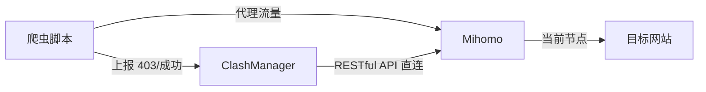

# 掘金 / CSDN / 博客园 长文

---

**标题**：海外数据采集的代理成本太高？我用机场「吃灰节点」搭了个代理池，开源了

**摘要**：商业海外代理按流量计费、价格昂贵；机场订阅的节点大多闲置。本文介绍一个开源工具 clash_proxy——通过 Clash RESTful API 把订阅节点变成带健康检测、负载均衡、自动切换的爬虫代理池，单文件实现、无框架依赖，含生产踩坑经验。

---

## 一、痛点：少量数据采集，代理成本却按"大规模"计价

做海外数据采集的同行应该都有体会，代理是整个流程里最贵的部分：

- 商业代理池（住宅 IP / 机房代理）按流量或 IP 数计费，一个月动辄几百上千；
- 采集任务往往只是"少量数据"——几千篇文献、几万条公开数据；
- 但代理服务不零售，你买的就是大规模的能力，大部分流量用不完。

另一边，很多人手里都有机场订阅：一个月几十块，二三十个节点。日常上网只用其中一两个，**剩下 90% 的节点全年吃灰**。

为什么不把这部分闲置节点管起来，变成自己的代理池？这就是 clash_proxy 要解决的问题。

## 二、方案：用 Clash RESTful API 管理订阅节点

Clash / Mihomo 都开放了 RESTful API（External Controller），通过它可以做到：

- `GET /proxies/{group}` 读取策略组里所有节点
- `GET /proxies/{name}/delay` 测试指定节点延迟
- `PUT /proxies/{group}` 把策略组切换到指定节点

管理逻辑就建立在这三个接口之上。整体架构：



爬虫进程内实例化一个 `ClashManager`，请求走本地代理端口；403 或下载计数触发自动切换。

## 三、核心设计：几个生产环境踩出来的坑

### 1. 只信 API 的 204 会被坑

`PUT /proxies/{group}` 返回 204 只代表"请求被接受"，不代表节点真能上网——节点可能欠费、被封、线路故障。所以切换必须**双重验证**：

1. API 确认策略组 `now` 已指向目标节点；
2. 经本地代理出口真实请求一次目标站，200/204 才算成功。

第二关过不去就立即换下一个候选节点，最多试 N 个。

### 2. 切换前先测延迟，别白等

最早版本的流程是"盲切 → sleep 3 秒 → 验证"。节点坏的时候，每次切换要白等好几秒。后来加了**预检**：切换前先用 API 测候选节点延迟，测不通的直接跳过——这省掉了大量无效等待。

### 3. 错误黑名单必须按站点隔离

一开始黑名单是全局的，结果发现：目标站 A 封了某节点的 IP，这个节点就被拉黑，导致访问目标站 B（本来没事）也不能用它了。改造成**黑名单 key 带上目标站域名**，A 站的封禁不影响 B 站。

### 4. 节点名的坑：过滤"流量"会误杀全部线路

从订阅里过滤非节点条目（"剩余流量""到期时间"等）是必须的。但**不能用"流量"两个字做过滤**——很多机场的节点名带"流量倍率"（如"香港01-0.1倍流量"），会把所有线路误杀干净。要用更精确的特征词。

### 5. 误杀保护：防止死锁

如果黑名单节点数接近节点总数（比如目标站突然大规模封 IP），按黑名单过滤后就没有可用节点了。发现两者数量接近时自动清空黑名单，并走全量扫描重新构建验证池。

## 四、负载均衡：四种策略

节点有限，流量调度更要讲究：

| 策略 | 行为 | 适用 |
|------|------|------|
| `round_robin` | 顺序轮换 | 默认，均匀分摊 |
| `random` | 随机挑选 | 节点质量参差时 |
| `least_403` | 403 历史最少的优先 | 目标站爱封 IP |
| `least_used` | 使用次数最少的优先 | 目标站对单 IP 频率敏感 |

每个节点的下载次数和 403 次数都会持久化（本地 JSON + 可选 Redis），作为调度依据。CLI 里 `stats` 命令可以直接看到负载分布：

```bash
$ python clash_cli.py stats
当前节点: 🇯🇵日本节点  策略: least_403
------------------------------------------------------------
节点                                    下载    403
🇯🇵日本节点                              45      1
🇸🇬狮城节点                              42      3
🇺🇸美国节点                              38      0
```

## 五、使用

```python
from clash_manager import ClashManager

manager = ClashManager({
    "api_url": "http://127.0.0.1:9099",
    "secret": "your-secret",
    "post_switch_test_url": "https://目标站/",   # 填实际采集的站
    "switch_strategy": "least_403",
    "max_downloads_per_node": 500,
})

proxies = manager.get_proxy_config()

for url in urls:
    resp = requests.get(url, proxies=proxies, timeout=30)
    if resp.status_code == 403:
        manager.increment_403_error()        # 3 次 403 自动切
    elif resp.status_code == 200:
        manager.increment_download_count()   # 500 次轮换
```

加上 Docker 部署的 Mihomo，`docker compose up -d` 即可在服务器跑起来。详细的从零到一教程在仓库 `docs/quickstart.md`。

## 六、边界

这个工具不是万能的，说清楚适用边界：

- ✅ 少量数据的海外采集：学术文献、公开数据、新闻资讯、API 数据；
- ❌ 每秒上百请求的大规模抓取——机场节点带宽有限，还是得用商业代理池。

## 七、总结

代理池的"池"字，不一定要买才配拥有。把订阅里闲置的节点管起来，节点读取、测速、轮换、负载均衡、失败切换，一个单文件搞定。项目已开源：

**GitHub: https://github.com/jimmy-Smile-ltl/clash_proxy**

MIT 协议，欢迎 Star、提 issue 一起完善。

---

## 附：发布建议

- 掘金：标签 `Python`、`爬虫`、`开源`、`后端`
- CSDN：分类 `Python` / `网络爬虫`
- 头图建议：架构图 + 徽章（README 中 mermaid 图导出为 PNG）
